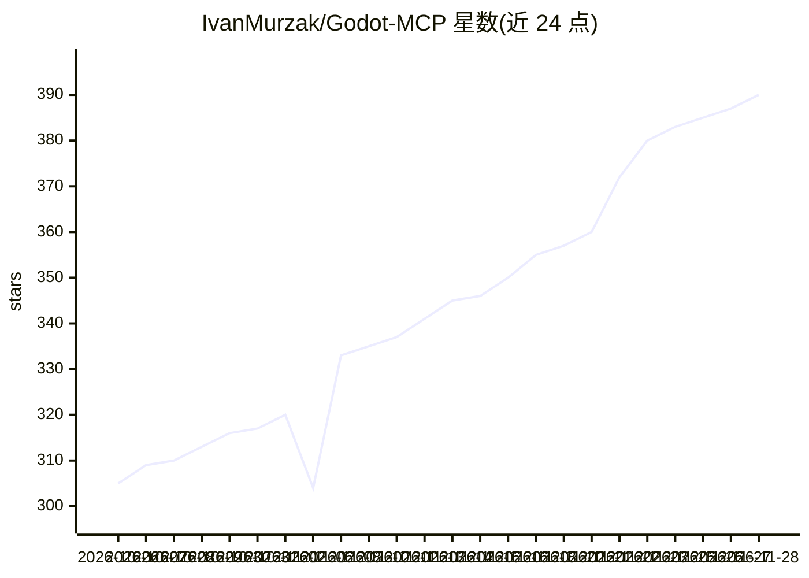

# IvanMurzak/Godot-MCP

⭐ 390 · C# · Apache-2.0 · 推送 2026-11-25 · [GitHub](https://github.com/IvanMurzak/Godot-MCP) · [官网](https://ai-game.dev) · 个人维护

**让 AI agent 通过 MCP 操作 Godot 编辑器的插件与 CLI**

Godot 编辑器插件（C#）与配套 CLI `godot-cli`：通过 MCP 协议把 Claude Code、Cursor、Codex、GitHub Copilot 等 MCP 客户端接入 Godot 编辑器，agent 可读写场景、节点、资源与脚本，运行 dotnet 构建、校验 GDScript、截图并查看运行中游戏的日志与错误。连接方式二选一：本地 GameDev-MCP-Server（无需账号）或 ai-game.dev 云中继（默认）。要求 Godot 4.3+ 的 .NET 版编辑器与 .NET SDK，支持 Windows/macOS/Linux。

## 筛选速览

| 维度 | 判定 | 备注 |
|---|---|---|
| AI 角色 | `ai-ecosystem` | LLM/agent 周边工具 |
| 许可风险 | `permissive` | Apache-2.0 |
| 部署形态 | `library` | 以包/库形式分发 |
| 模型依赖 | — | README 未给出锁定关系 |
| 硬件要求 | — | 无带数字的原话,不猜 |
| 安装摩擦 | `medium` | 含编译或系统依赖之一 |
| 成熟度 | — | 结构信号不足 |

## 能力要点

- agent 可执行场景/节点/资源的查询与修改（RQL 工具）、脚本创建与 C# 构建
- 支持截图回传与运行中游戏的日志、反射、运行时错误读取（opt-in）
- 本地服务器与 ai-game.dev 云中继两种连接模式，无遥测
- setup-mcp 命令为多款 MCP 客户端自动写入配置

## 适用场景

- 用自然语言让 AI agent 修改 Godot 场景与节点
- 让 agent 构建 C# 并读取编译错误自动修复
- 游戏运行后让 agent 读取报错并定位修复

## 场景标签

`编码 Agent` · 领域:编码与开发

## 证据(README 行号)

> L8: **Godot-MCP** connects AI agents (Claude Code, Cursor, Codex, GitHub Copilot, Gemini or any other MCP client) to the
> L40:  An AI agent talks MCP to a server (ai-game.dev, or a local gamedev-mcp-server); the server reaches the godot_mcp e
> L42: The addon connects out to an MCP server, and your agent connects to the same server and calls the addon's tools. Th

## 星数曲线

2026-10-26 305 → 2026-11-28 390（+85）

---
*卡片 v1 · prompt 1.4 · 生成 2026-11-25 · 置信度 high · 依据 README sha `c271151eabf5` · [字段定义](../../DATASET.md)*
