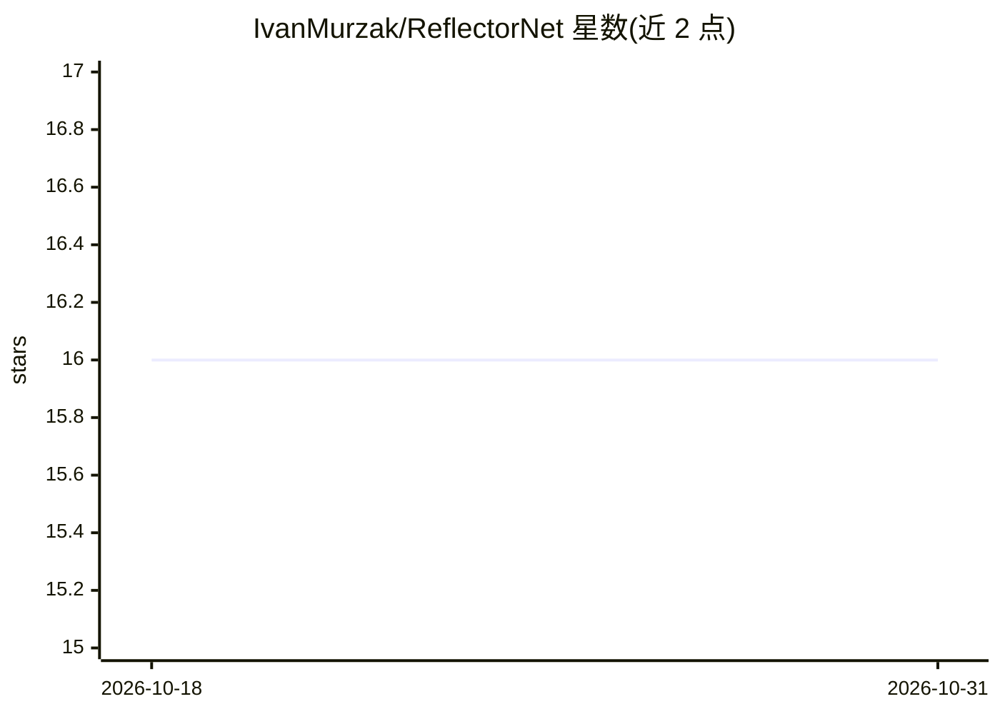

# IvanMurzak/ReflectorNet

⭐ 16 · C# · Apache-2.0 · 推送 2026-10-30 · [GitHub](https://github.com/IvanMurzak/ReflectorNet) · 个人维护

**.NET 反射工具库：面向 AI 场景的动态调用与类型保持序列化**

面向动态自动化、AI 辅助工具、测试与运行时检查的 .NET 反射工具包。核心数据模型 SerializedMember 以 JSON 友好形式保存成员名、解析类型与值载荷，支持类型保持序列化/反序列化、就地修改对象、路径读写、JSON Merge Patch 式补丁、Regex 对象图搜索、JSON Schema 生成，以及按模糊匹配发现并动态调用方法。可扩展反射与 JSON 转换器注册表，并提供类型黑名单机制。以 NuGet 包分发，目标框架 netstandard2.1、net8.0、net9.0。

## 筛选速览

| 维度 | 判定 | 备注 |
|---|---|---|
| AI 角色 | `ai-ecosystem` | LLM/agent 周边工具 |
| 许可风险 | `permissive` | Apache-2.0 |
| 部署形态 | `None` |  |
| 模型依赖 | — | README 未给出锁定关系 |
| 硬件要求 | — | 无带数字的原话,不猜 |
| 安装摩擦 | `medium` | 含编译或系统依赖之一 |
| 成熟度 | — | 结构信号不足 |

## 能力要点

- SerializedMember 类型保持序列化与循环引用 $ref 处理
- 路径式读写与 JSON Merge Patch 式多字段修改
- 模糊方法发现与 MethodCall 动态调用
- 类型/方法参数/返回值的 JSON Schema 生成

## 适用场景

- 为 AI function calling 生成类型与方法的 JSON Schema
- 通过 JSON 描述在运行时动态发现并调用 .NET 方法
- 对有状态系统（游戏、编辑器、测试）就地修改对象而不替换根引用

## 场景标签

 · 领域:开发工具/.NET 库

## 证据(README 行号)

> L14: ReflectorNet is a .NET reflection toolkit for dynamic automation, AI-assisted tooling, testing, and runtime inspect

## 星数曲线

2026-10-18 16 → 2026-10-31 16（+0）

---
*卡片 v1 · prompt 1.4 · 生成 2026-10-30 · 置信度 high · 依据 README sha `227c226af8c3` · [字段定义](../../DATASET.md)*
