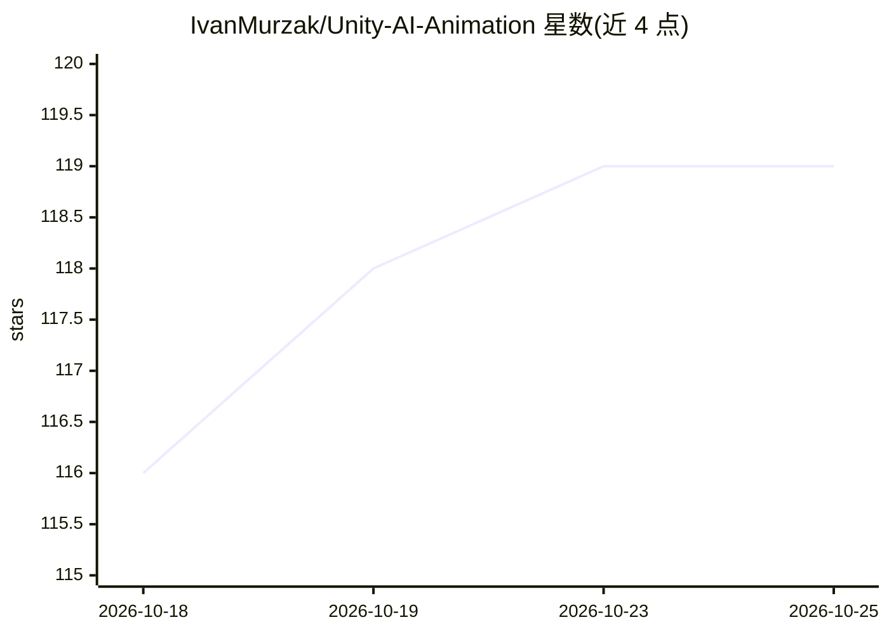

# IvanMurzak/Unity-AI-Animation

⭐ 119 · C# · MIT · 推送 2026-10-16 · [GitHub](https://github.com/IvanMurzak/Unity-AI-Animation) · [官网](https://ai-game.dev) · 个人维护

**通过 MCP/RQL 用自然语言编辑 Unity 动画与 Animator 的工具包**

面向 Unity 开发者的 AI 动画工作流工具包：以 MCP 集成形式提供，从 Unity-MCP 1.0.0 起不再添加独立 MCP 工具，而是贡献一个 RQL 模块，供 agent 通过 rql-query/rql-mutate 创建与修改 AnimationClips 和 AnimatorControllers，如添加关键帧、曲线、事件、状态机状态与转换。适用于快速原型、程序化动画生成与简化复杂 Animator 配置。提供安装器导入 Unity 包或经 OpenUPM-CLI 安装，README 附多个 Unity 版本下 Editmode/Playmode/Standalone 的稳定性状态表。

## 筛选速览

| 维度 | 判定 | 备注 |
|---|---|---|
| AI 角色 | `ai-ecosystem` | LLM/agent 周边工具 |
| 许可风险 | `permissive` | MIT |
| 部署形态 | `None` |  |
| 模型依赖 | — | README 未给出锁定关系 |
| 硬件要求 | — | 无带数字的原话,不猜 |
| 安装摩擦 | `low` | 无编译、无系统依赖或容器化 |
| 成熟度 | — | 结构信号不足 |

## 能力要点

- 以 RQL 模块提供动画与 Animator 的创建/读取/修改能力（rql-query / rql-mutate）
- 支持曲线、关键帧、动画事件、状态、参数、转换等操作的命令示例
- 提供安装器导入与 OpenUPM-CLI 两种安装方式
- 列出 2022.3–6000.3 多个 Unity 版本的稳定性状态表

## 适用场景

- 让 AI agent 通过自然语言搭建和修改 Animator 状态机
- 快速原型阶段批量创建与调整动画片段
- 自动化重复性动画配置（转换条件、参数、事件等）

## 场景标签

 · 领域:游戏开发/Unity 工具

## 证据(README 行号)

> L14: AI-powered tools for Unity animation workflow. Create and modify AnimationClips and AnimatorControllers directly th
> L34: With Unity-MCP 1.0.0 this package adds no MCP tools: it contributes an RQL module, so agents use

## 星数曲线

2026-10-18 116 → 2026-10-25 119（+3）

---
*卡片 v1 · prompt 1.4 · 生成 2026-10-23 · 置信度 high · 依据 README sha `7008f7c1215a` · [字段定义](../../DATASET.md)*
