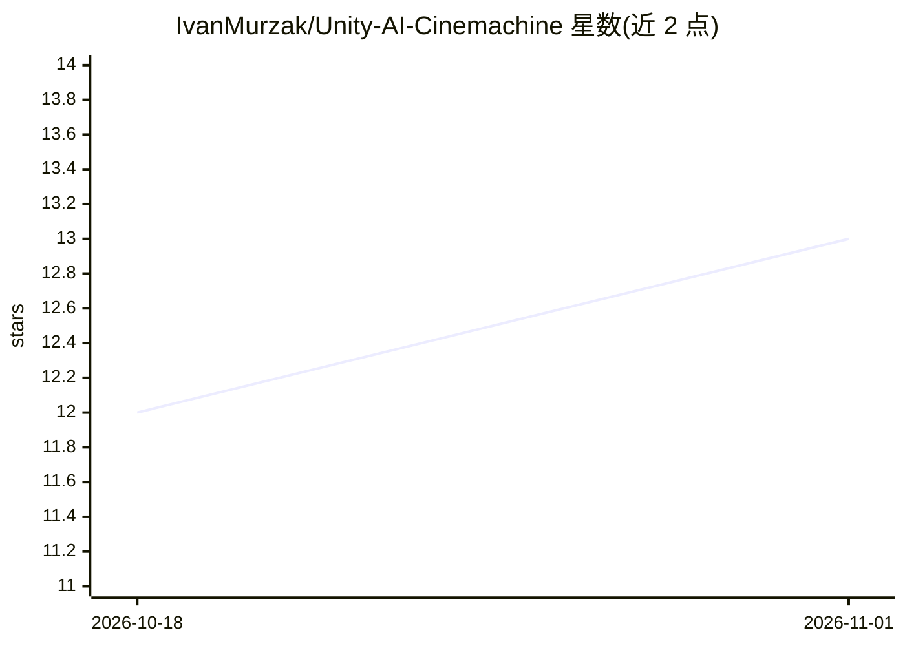

# IvanMurzak/Unity-AI-Cinemachine

⭐ 13 · C# · MIT · 推送 2026-10-16 · [GitHub](https://github.com/IvanMurzak/Unity-AI-Cinemachine) · [官网](https://ai-game.dev) · 个人维护

**Unity Cinemachine 的 MCP 工具包：用自然语言编辑虚拟相机**

面向 Unity 开发者的编辑器增强包：通过 MCP/RQL 接口让 AI agent 创建和配置 Cinemachine 虚拟相机、设置 Follow/LookAt 目标、构建 Body/Aim/Noise/Lens 管线、调整优先级与默认混合，可直接修改任意 Cinemachine 组件字段。基于 Unity-MCP 1.0.0 以 RQL 模块形式提供（cinemachine | get/set/call 查询语法），封装 com.unity.cinemachine 3.1.6，依赖 AI Game Developer 平台。支持 Unity 2022.3/2023.2/6000.3，提供安装包导入或 OpenUPM-CLI 两种安装方式。

## 筛选速览

| 维度 | 判定 | 备注 |
|---|---|---|
| AI 角色 | `ai-ecosystem` | LLM/agent 周边工具 |
| 许可风险 | `permissive` | MIT |
| 部署形态 | `None` |  |
| 模型依赖 | — | README 未给出锁定关系 |
| 硬件要求 | — | 无带数字的原话,不猜 |
| 安装摩擦 | `low` | 无编译、无系统依赖或容器化 |
| 成熟度 | — | 结构信号不足 |

## 能力要点

- 以 RQL 查询语法（rql-query/rql-mutate）驱动 Cinemachine 操作
- 覆盖相机创建、目标绑定、管线配置、混合调优等全流程
- 可 set 修改任意 Cinemachine 组件字段
- 声明支持 Unity 2022.3 / 2023.2 / 6000.3 三版本

## 适用场景

- 让 AI agent 用自然语言搭建游戏相机与运镜管线
- 快速进行镜头调度、过场动画相机设置
- 程序化生成与批量调整相机装备

## 场景标签

 · 领域:游戏开发/Unity 编辑器工具

## 证据(README 行号)

> L14: AI-powered tools for the Unity Cinemachine workflow. Create and configure virtual cameras, set Follow / Look At tar
> L34: With Unity-MCP 1.0.0 this package adds no MCP tools: it contributes an RQL module, so agents use

## 星数曲线

2026-10-18 12 → 2026-11-01 13（+1）

---
*卡片 v1 · prompt 1.4 · 生成 2026-10-31 · 置信度 high · 依据 README sha `903dfcd064c8` · [字段定义](../../DATASET.md)*
