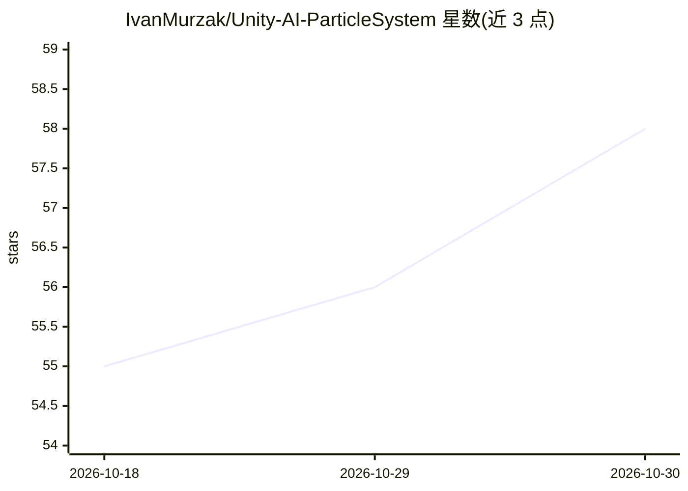

# IvanMurzak/Unity-AI-ParticleSystem

⭐ 58 · C# · MIT · 推送 2026-10-16 · [GitHub](https://github.com/IvanMurzak/Unity-AI-ParticleSystem) · [官网](https://ai-game.dev) · 个人维护

**Unity 粒子系统 MCP 工具：让 AI 通过自然语言编辑粒子特效**

面向 Unity Editor 的 AI 辅助粒子系统工作流工具包：通过 MCP（Model Context Protocol）与 RQL 查询语言，让 AI agent 检查和修改 ParticleSystem 组件，覆盖全部 24 个模块（发射、形状、速度曲线、颜色渐变等），无需手动在 Inspector 中导航。当前版本不再添加独立 MCP 工具，而是贡献一个 RQL 模块，agent 通过 rql-query/rql-mutate 操作粒子系统。支持 Unity 2022.3 至 6000.3 版本，通过安装器导入或 OpenUPM-CLI 安装，构建于 AI Game Developer 平台之上。

## 筛选速览

| 维度 | 判定 | 备注 |
|---|---|---|
| AI 角色 | `ai-ecosystem` | LLM/agent 周边工具 |
| 许可风险 | `permissive` | MIT |
| 部署形态 | `None` |  |
| 模型依赖 | — | README 未给出锁定关系 |
| 硬件要求 | — | 无带数字的原话,不猜 |
| 安装摩擦 | `low` | 无编译、无系统依赖或容器化 |
| 成熟度 | — | 结构信号不足 |

## 能力要点

- 通过自然语言命令检查与修改 ParticleSystem 组件
- 以 RQL 模块方式提供 rql-query/rql-mutate 访问粒子系统
- 支持全部 24 个粒子系统模块的读写
- 兼容 Unity 2022.3/2023.2/6000.3 的 Editmode、Playmode 与 Standalone

## 适用场景

- 用对话让 AI 快速搭建和调整粒子特效
- 程序化生成粒子效果、加速原型迭代
- 在 VS Code 或 Visual Studio 工作流中用 agent 操作粒子系统

## 场景标签

 · 领域:游戏开发/Unity 编辑器工具

## 证据(README 行号)

> L14: AI-powered tools for Unity ParticleSystem workflow. Inspect and modify ParticleSystem components directly through n
> L34: This package adds no MCP tools: it contributes an RQL module, so agents use `rql-query` / `rql-mutate` (the `unity-

## 星数曲线

2026-10-18 55 → 2026-10-30 58（+3）

---
*卡片 v1 · prompt 1.4 · 生成 2026-10-24 · 置信度 high · 依据 README sha `e7830488651d` · [字段定义](../../DATASET.md)*
