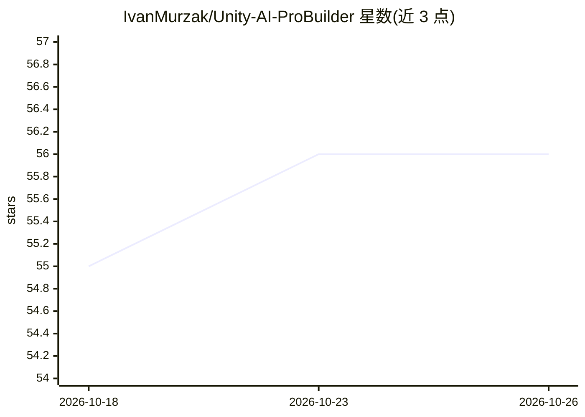

# IvanMurzak/Unity-AI-ProBuilder

⭐ 56 · C# · Apache-2.0 · 推送 2026-10-16 · [GitHub](https://github.com/IvanMurzak/Unity-AI-ProBuilder) · [官网](https://ai-game.dev) · 个人维护

**让 AI 助手用自然语言建模的 Unity ProBuilder MCP 工具**

面向 Unity ProBuilder 的 MCP 工具包，使 AI 助手能够创建与编辑可编辑网格：生成基础形体、挤出面、倒角边、桥接与细分、合并对象、按材质设置面、按方向语义选面等操作。自 Unity-MCP 1.0.0 起不再新增独立 MCP 工具，而是提供 RQL 模块，通过 rql-query/rql-mutate 配合 unity-rql 技能调用；每次调用先校验输入且支持撤销。支持 Unity 2022.3/2023.2/6000.3 的编辑模式、播放模式与独立构建。通过安装器导入或 OpenUPM-CLI 安装。

## 筛选速览

| 维度 | 判定 | 备注 |
|---|---|---|
| AI 角色 | `ai-ecosystem` | LLM/agent 周边工具 |
| 许可风险 | `permissive` | Apache-2.0 |
| 部署形态 | `None` |  |
| 模型依赖 | — | README 未给出锁定关系 |
| 硬件要求 | — | 无带数字的原话,不猜 |
| 安装摩擦 | `low` | 无编译、无系统依赖或容器化 |
| 成熟度 | — | 结构信号不足 |

## 能力要点

- AI 助手经自然语言创建/编辑 ProBuilder 网格
- RQL 模块：rql-query/rql-mutate 承载原 ProBuilder 工具的全部操作
- 每次调用先校验输入且可撤销
- 兼容 Unity 2022.3/2023.2/6000.3 三版本三种运行模式

## 适用场景

- 用 AI 对话快速搭建关卡原型
- 通过 agent 生成程序化几何体
- 在 Unity 编辑器里让 AI 助手执行网格编辑操作

## 场景标签

 · 领域:游戏开发/3D 建模

## 证据(README 行号)

> L14: AI-powered 3D modeling tools for Unity ProBuilder. Enables AI assistants to create and manipulate editable meshes t
> L34: Since Unity-MCP 1.0.0 this package adds no MCP tools: it contributes an RQL module, so agents use

## 星数曲线

2026-10-18 55 → 2026-10-26 56（+1）

---
*卡片 v1 · prompt 1.4 · 生成 2026-10-24 · 置信度 high · 依据 README sha `084223a2672e` · [字段定义](../../DATASET.md)*
