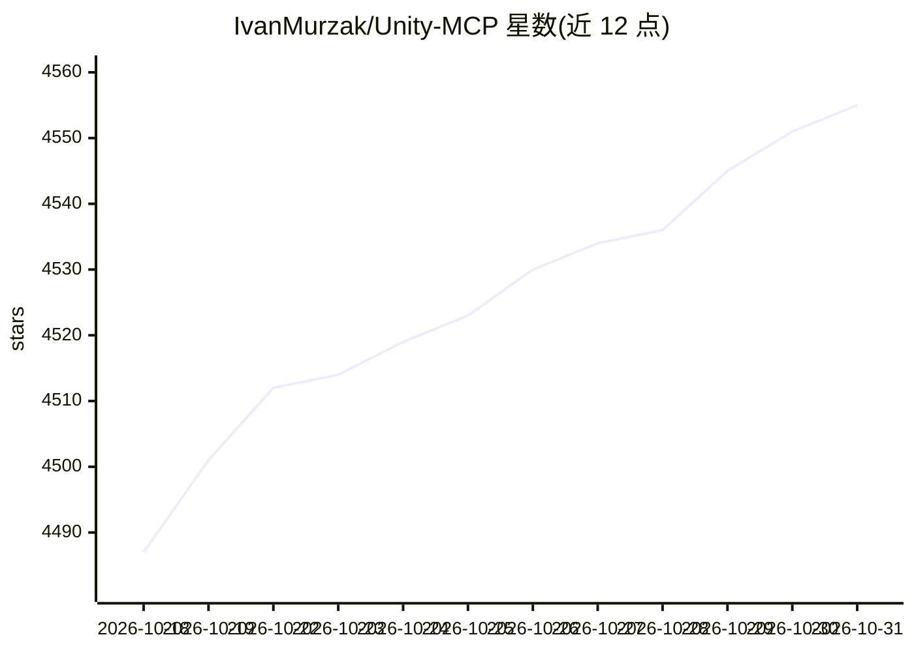

# IvanMurzak/Unity-MCP

⭐ 4,555 · C# · Apache-2.0 · 推送 2026-10-30 · [GitHub](https://github.com/IvanMurzak/Unity-MCP) · [官网](https://ai-game.dev) · 个人维护

**面向 Unity 的 MCP 工具与 AI 技能插件，让 AI agent 操作编辑器与运行时**

Unity 编辑器与运行时插件，通过 MCP 协议将 Claude Code、Cursor、Copilot、Gemini 等 AI agent 接入 Unity。提供 70+ 内置工具（资产/场景管理、脚本读写与 Roslyn 动态执行、测试运行、性能快照、截图等），可基于项目环境自动生成 AI Skills，任意 C# 方法可经反射注册为工具；支持 stdio/http 两种部署及 Docker。运行时模式可在编译后的游戏内调用 LLM。安装提供 unitypackage 安装包、OpenUPM 包与 npm CLI 三种途径，要求项目路径不含空格。

## 筛选速览

| 维度 | 判定 | 备注 |
|---|---|---|
| AI 角色 | `ai-ecosystem` | LLM/agent 周边工具 |
| 许可风险 | `permissive` | Apache-2.0 |
| 部署形态 | `desktop` | 安装包/桌面程序 |
| 模型依赖 | locked-api |  |
| 硬件要求 | — | 无带数字的原话,不猜 |
| 安装摩擦 | `low` | 无编译、无系统依赖或容器化 |
| 成熟度 | — | 结构信号不足 |

## 能力要点

- 70+ 内置 MCP 工具覆盖资产、场景、脚本、测试与性能分析
- 任意 C# 方法经单行注册转为 MCP 工具，可在项目代码中自定义工具
- 运行时模式：在编译后的游戏内使用 LLM（NPC 行为/调试）
- 本地 stdio 与远程 http 部署，附 Docker 部署指南

## 适用场景

- 让 Claude Code/Cursor 等 agent 在 Unity 中自动创建资产、修改场景与生成代码
- AI agent 运行 Unity 测试并读取日志调试项目
- 游戏运行时接入 LLM 实现动态 NPC 行为

## 场景标签

`编码 Agent` · 领域:编码与开发

## 证据(README 行号)

> L32: `Unity MCP` is an AI-powered game development assistant **for Editor & Runtime**. Connect **Claude**, **Cursor**, &
> L40: - ✔️ **AI agents** - Use the best agents from **Anthropic**, **OpenAI**, **Microsoft**, or any other provider with 
> L47: - ✔️ **Flexible deployment** - Works locally (stdio) and remotely (http) via configuration

## 星数曲线

2026-10-18 4,487 → 2026-10-31 4,555（+68）

---
*卡片 v1 · prompt 1.4 · 生成 2026-10-20 · 置信度 high · 依据 README sha `1dcdd9b31d2e` · [字段定义](../../DATASET.md)*
