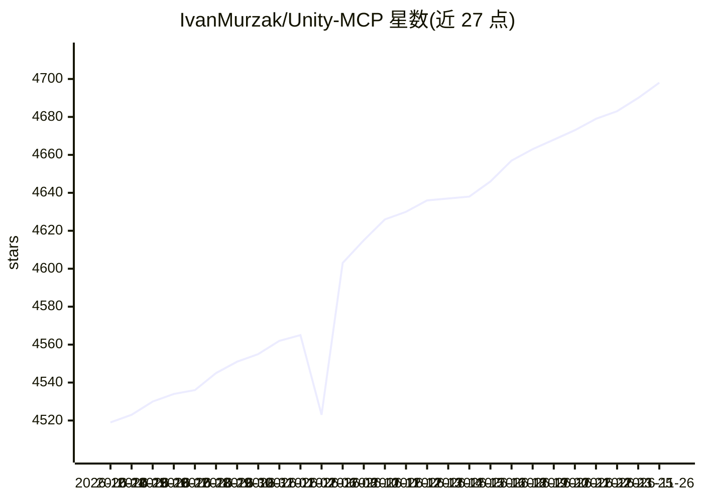

# IvanMurzak/Unity-MCP

⭐ 4,698 · C# · Apache-2.0 · 推送 2026-11-24 · [GitHub](https://github.com/IvanMurzak/Unity-MCP) · [官网](https://ai-game.dev) · 个人维护

**把 AI 代理接入 Unity 编辑器与运行中游戏的 MCP 工具与 CLI**

Unity-MCP 通过 MCP 服务器将 AI 代理连接到 Unity 编辑器和运行中的游戏：代理可读取与修改场景、预制体、资源和 C# 代码，运行 EditMode/PlayMode 测试并截屏；任意 C# 方法可通过 [AiTool] 特性注册为工具。提供 Unity 插件包、unity-mcp-cli 命令行工具和可选扩展包。服务器可选本地（127.0.0.1，无需账号）或 ai-game.dev 云端（默认，免费）。支持 Skills 或 MCP 两种接入方式，要求 Unity 2022.3 及以上，支持 Windows/macOS/Linux。

## 筛选速览

| 维度 | 判定 | 备注 |
|---|---|---|
| AI 角色 | `ai-ecosystem` | LLM/agent 周边工具 |
| 许可风险 | `permissive` | Apache-2.0 |
| 部署形态 | `desktop` | 安装包/桌面程序 |
| 模型依赖 | — | README 未给出锁定关系 |
| 硬件要求 | — | 无带数字的原话,不猜 |
| 安装摩擦 | `low` | 无编译、无系统依赖或容器化 |
| 成熟度 | — | 结构信号不足 |

## 能力要点

- RQL 查询语言一次调用读写场景、对象、资源与设置
- 任意 C# 方法通过 [AiTool] 特性一行声明为代理工具
- 内置游戏运行时工具：NPC 逻辑与实时调试
- 提供 OpenUPM/unitypackage 安装与 Unity 2022.3–6000.x 的 CI 测试

## 适用场景

- 让 Claude Code 或 Cursor 直接操作 Unity 场景与资源完成开发任务
- 从终端或 CI 用 CLI 编译、运行测试并查询场景对象
- 在构建出的游戏内接入 MCP 工具做实时调试
- 一键生成 Skills 供不使用 MCP 的代理使用

## 场景标签

`编码 Agent` · 领域:编码与开发

## 证据(README 行号)

> L21: **AI Game Developer** (Unity-MCP) connects your AI agent to Unity. Claude Code, Codex, Cursor, GitHub Copilot, Gemi
> L27:  An AI agent or unity-mcp-cli talks MCP to a server, ai-game.dev Cloud by default or a local gamedev-mcp-server, wh
> L29: The plugin registers its tools with an MCP server; your agent calls them through that server. Instead of MCP tools,

## 星数曲线

2026-10-24 4,519 → 2026-11-26 4,698（+179）

---
*卡片 v1 · prompt 1.4 · 生成 2026-11-22 · 置信度 high · 依据 README sha `d964fb393168` · [字段定义](../../DATASET.md)*
