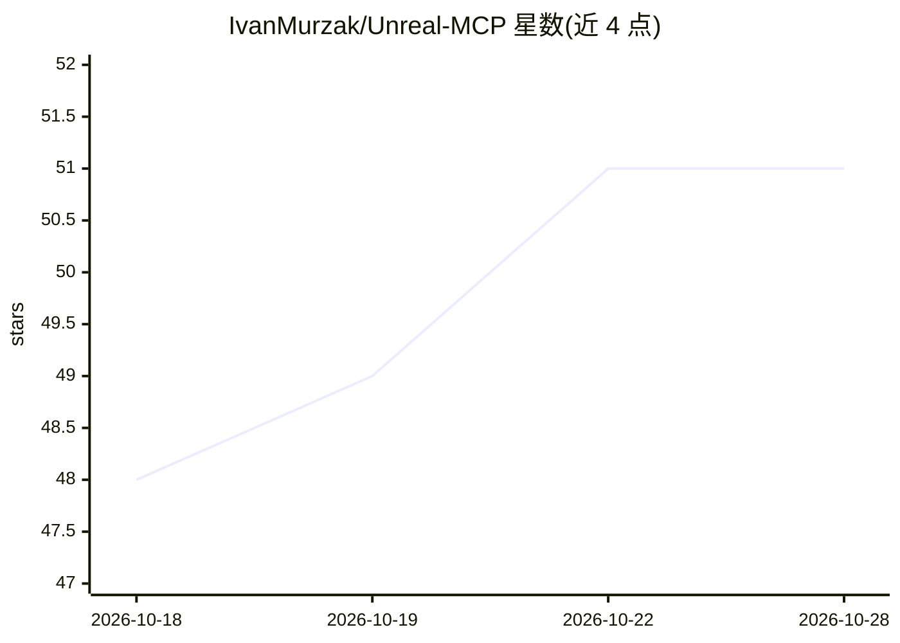

# IvanMurzak/Unreal-MCP

⭐ 51 · C++ · Apache-2.0 · 推送 2026-10-27 · [GitHub](https://github.com/IvanMurzak/Unreal-MCP) · [官网](https://ai-game.dev) · 个人维护

**把 Unreal Editor 接入 MCP AI agent 的 C++ 插件**

面向 Unreal Engine 5.5+ 的 C++ 编辑器插件：将编辑器操作（生成 Actor、编辑关卡、编写并编译 Blueprint 与 C++、管理资产、截图等）暴露为 MCP Tools，通过 .NET sidecar 进程（unreal-mcp-bridge，localhost IPC）连接 ai-game.dev 云后端或自托管 GameDev-MCP-Server，供 Claude、Cursor、Copilot 等 MCP 客户端调用。提供 25 个内建工具与 RQL 查询语言，允许其他 UE 插件无 fork 注册自定义工具。安装途径为 unreal-mcp-cli（npm）或手动拷贝源码，需 C++ Unreal 项目；Fab/Marketplace 渠道尚未上线。截图工具需 GPU 编辑器，其余可 headless 运行。

## 筛选速览

| 维度 | 判定 | 备注 |
|---|---|---|
| AI 角色 | `ai-ecosystem` | LLM/agent 周边工具 |
| 许可风险 | `permissive` | Apache-2.0 |
| 部署形态 | `desktop` | 安装包/桌面程序 |
| 模型依赖 | — | README 未给出锁定关系 |
| 硬件要求 | — | 无带数字的原话,不猜 |
| 安装摩擦 | `medium` | 含编译或系统依赖之一 |
| 成熟度 | `idea` | |

## 能力要点

- 25 个内建 MCP 工具（5 个家族）+ RQL 统一查询/修改编辑器数据
- AI agent 可创建、编辑并编译 Blueprint 与项目 C++，带结构化错误反馈
- 任何 UE 插件可无 fork 注册自定义 AI Tools、Prompts、Resources
- 云端 ai-game.dev 或自托管 GameDev-MCP-Server 两种连接模式

## 适用场景

- 让 Claude/Cursor 等 AI agent 直接操作 Unreal 编辑器搭建关卡和资产
- 通过 RQL 用统一语言查询和修改 Actor、组件与编辑器状态
- 为 Unreal 工作流编写自定义 MCP 工具供 AI 调用

## 场景标签

`GUI 自动化` · 领域:效率与自动化

## 证据(README 行号)

> L29: `Unreal MCP` is an AI-powered game development assistant **for the Unreal Editor**. Connect **Claude**, **Cursor**,
> L31: Unreal-MCP is the Unreal Engine counterpart of Unity-MCP and Godot-MCP: a **C++ editor plugin** that exposes Unreal
> L43: - ✔️ **25 built-in Tools** — MCP Tools across **5 families** for operating the Unreal Editor

## 星数曲线

2026-10-18 48 → 2026-10-28 51（+3）

---
*卡片 v1 · prompt 1.4 · 生成 2026-10-24 · 置信度 high · 依据 README sha `0d89972ef948` · [字段定义](../../DATASET.md)*
