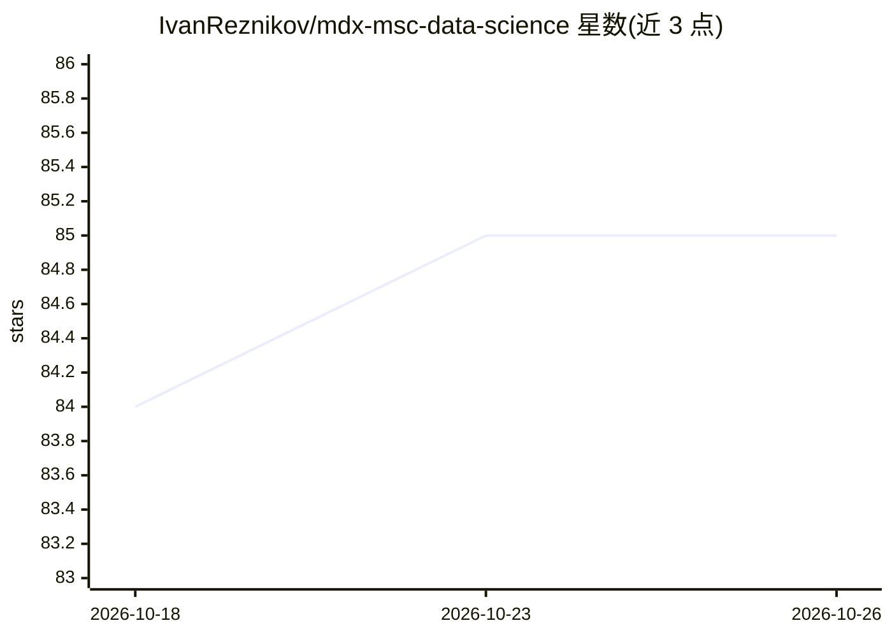

# IvanReznikov/mdx-msc-data-science

⭐ 85 · Jupyter Notebook · 推送 2026-10-11 · [GitHub](https://github.com/IvanReznikov/mdx-msc-data-science) · [官网](https://www.mdx.ac.ae/courses/course-list/course-detail/msc-data-science) · 组织维护

**迪拜密德萨斯大学数据科学硕士课程资料库**

Middlesex University Dubai 数据科学硕士课程（建模、回归与机器学习方向）的教学资料仓库，由 Dr. Ivan Reznikov 授课维护。README 声明仓库将存放该方向的课程材料，并给出课程官方页面链接。内容面向选课学生，主题标签涉及数据科学、机器学习、Python 与统计学。README 未列出具体材料清单、安装或运行方式。

## 筛选速览

| 维度 | 判定 | 备注 |
|---|---|---|
| AI 角色 | `ai-knowledge` | 知识聚合/清单类 |
| 许可风险 | `none` | — |
| 部署形态 | `None` |  |
| 模型依赖 | — | README 未给出锁定关系 |
| 硬件要求 | — | 无带数字的原话,不猜 |
| 安装摩擦 | `low` | 无编译、无系统依赖或容器化 |
| 成熟度 | — | 结构信号不足 |

## 能力要点

- 数据科学硕士课程方向的资料汇总仓库
- 主题覆盖数据科学、机器学习、Python、统计学

## 适用场景

- 选课学生获取课程材料
- 了解该硕士课程方向的内容范围

## 场景标签

`教程课程` · 领域:学习与行业

## 证据(README 行号)

> L3: MSc Data Science course: Modelling, Regression and Machine Learning track
> L6: The repo will contain materials of the track

## 星数曲线

2026-10-18 84 → 2026-10-26 85（+1）

---
*卡片 v1 · prompt 1.4 · 生成 2026-10-24 · 置信度 mid · 依据 README sha `e49481691243` · [字段定义](../../DATASET.md)*
