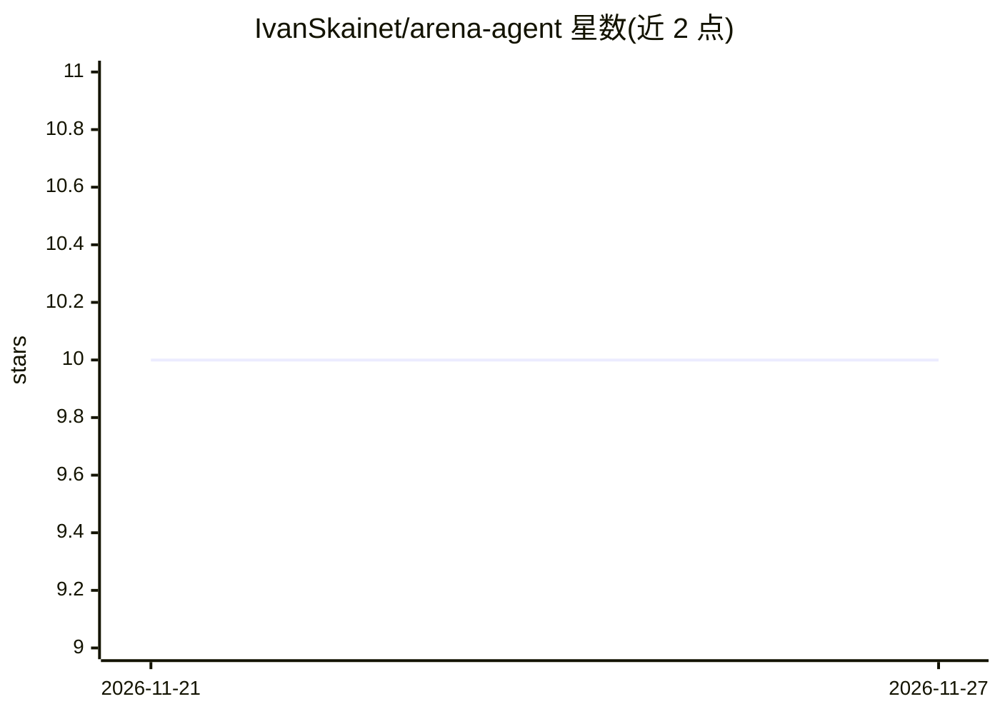

# IvanSkainet/arena-agent

⭐ 10 · Python · MIT · 推送 2026-11-26 · [GitHub](https://github.com/IvanSkainet/arena-agent) · [官网](https://github.com/IvanSkainet/arena-agent#readme) · 个人维护

**本地自动化桥：让 AI agent 安全操作你的机器**

单进程单端口的本地自动化桥，将 MCP server/client、REST API、WebSocket 事件与浏览器扩展统一到一个经 bearer 认证的本地运行时，让 ChatGPT/Claude/Gemini 等对话中的 agent 触发真实本机操作：执行命令（默认 allowlist 的 cautious profile）、文件读写、网页抓取、浏览器 CDP 自动化、桌面截图与输入、持久记忆与后台任务。安全层包含路径限制、shell 安全模式、风险策略与沙箱黑名单；agent 可在运行时通过 custom.create 自建工具，自我扩展环境。支持 Windows/Linux/macOS。

## 筛选速览

| 维度 | 判定 | 备注 |
|---|---|---|
| AI 角色 | `ai-ecosystem` | LLM/agent 周边工具 |
| 许可风险 | `permissive` | MIT |
| 部署形态 | `library` | 以包/库形式分发 |
| 模型依赖 | — | README 未给出锁定关系 |
| 硬件要求 | — | 无带数字的原话,不猜 |
| 安装摩擦 | `medium` | 含编译或系统依赖之一 |
| 成熟度 | — | 结构信号不足 |

## 能力要点

- 单进程统一 MCP + REST + WebSocket/SSE + 浏览器扩展多协议接入
- 双安全 profile：默认 cautious 首词 allowlist，owner-shell 显式移交
- agent 运行时自建可持久、可撤销的工具（custom.create/custom.remove）
- 统一 /v1/tunnels 远程访问：Tailscale、Cloudflare、ZeroTier 故障切换池

## 适用场景

- 让 AI 聊天助手直接操作本机文件、命令与浏览器
- 自托管单服务替代多个 MCP/REST/浏览器控制服务器
- 给 agent 搭建可扩展、带风险策略的工具运行环境

## 场景标签

`浏览器自动化` `网页抓取` `GUI 自动化` · 领域:效率与自动化

## 证据(README 行号)

> L108: Most "AI + your computer" setups mean juggling several servers: one for MCP, one
> L116: - **Protocol-agnostic.** REST, MCP, WebSocket/SSE events, and a browser extension

## 星数曲线

2026-11-21 10 → 2026-11-27 10（+0）

---
*卡片 v1 · prompt 1.4 · 生成 2026-11-21 · 置信度 mid · 依据 README sha `0688d3430726` · [字段定义](../../DATASET.md)*
