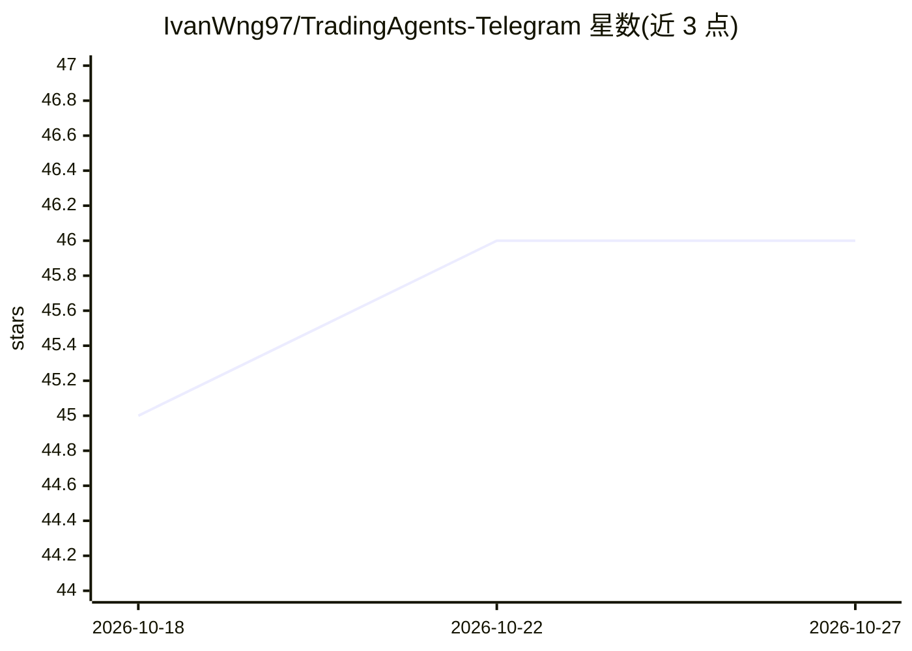

# IvanWng97/TradingAgents-Telegram

⭐ 46 · Python · MIT · 推送 2026-08-16 · [GitHub](https://github.com/IvanWng97/TradingAgents-Telegram) · [官网](https://t.me/TheTradingAgents_bot) · 个人维护

**在 Telegram 中运行 TradingAgents 多智能体股票分析的 bot**

封装 TradingAgents 框架的 Telegram bot：用户通过 /add /watch 管理股票观察列表，选择一个或多个 ticker 后调用 TradingAgentsGraph.propagate 并行运行 analyst→researcher→trader→risk-manager 多智能体流水线，回复 finviz 图表、交易决策、摘要及 Telegraph 全文链接；支持实时进度与逐 LLM 调用边界的取消、当日结果缓存、定时日报（含交易所日历门控）、Resend 邮件镜像（可选）。LLM 供应商经 .env 单租户配置，支持 OpenAI、DeepSeek、Anthropic、Ollama 等十余种。通过 start.sh 脚本或多架构 Docker 镜像部署，每次分析约 12 次 LLM 调用，输出为 LLM 生成、非投资建议。

## 筛选速览

| 维度 | 判定 | 备注 |
|---|---|---|
| AI 角色 | `ai-native` | 本体是模型或模型工具 |
| 许可风险 | `permissive` | MIT |
| 部署形态 | `self-host` | docker 或自建部署 |
| 模型依赖 | local-ok | 支持本地模型 |
| 硬件要求 | — | 无带数字的原话,不猜 |
| 安装摩擦 | `low` | 无编译、无系统依赖或容器化 |
| 成熟度 | — | 结构信号不足 |

## 能力要点

- 多 ticker 并行分析（并发上限可配）＋逐步进度流式回传与近即时取消
- 当日同 ticker 结果缓存，多用户/日报命中同一分析只跑一次 LLM
- 定时日报含 102 个交易所的闭市日历门控，可选 Resend 邮件镜像
- 单租户 .env 配置十余种 LLM 供应商（OpenAI/DeepSeek/Ollama/Bedrock 等），叠加于 tradingagents 默认配置

## 适用场景

- 在 Telegram 里维护股票观察列表并一键获取多智能体交易分析
- 每天定时对选定子集跑分析并收到汇总消息与邮件
- 回顾历史分析（按 ticker 与日期）并按需重新发布

## 场景标签

`金融量化` `聊天机器人` · 领域:对话与助手

## 证据(README 行号)

> L13: Telegram bot wrapping the TradingAgents framework. Curate a watchlist via Telegram, tap one or more tickers, and th
> L17: - 🤖 **Multi-Agent Analysis**: Wraps TradingAgents — analyst → researcher → trader → risk-manager LLM agents collabo
> L25: - 🤹 **Single-tenant `.env`-driven LLM config**: OpenAI, DeepSeek, Anthropic, Google, xAI, Qwen, GLM, MiniMax, Ollam

## 星数曲线

2026-10-18 45 → 2026-10-27 46（+1）

---
*卡片 v1 · prompt 1.4 · 生成 2026-10-25 · 置信度 high · 依据 README sha `cf84cfc0ec30` · [字段定义](../../DATASET.md)*
