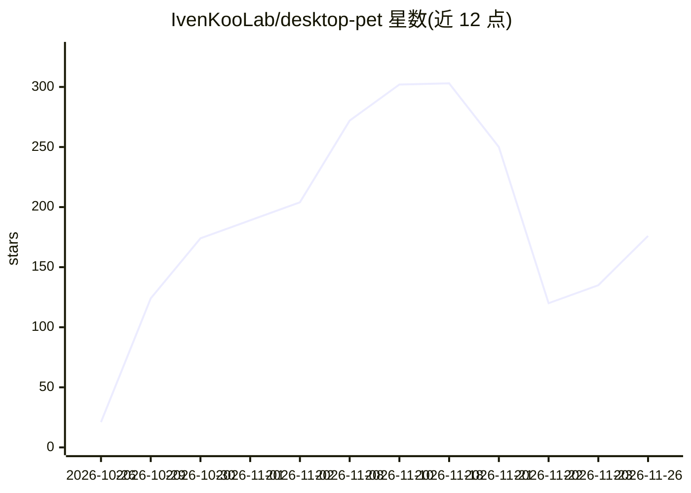

# IvenKooLab/desktop-pet

⭐ 176 · Python · MIT · 推送 2026-11-11 · [GitHub](https://github.com/IvenKooLab/desktop-pet) · [官网](https://github.com/IvenKooLab/desktop-pet/releases/latest) · 个人维护 · 中文 README

**面向编码工作者的 3D 桌宠，可跟随本地编码助手状态**

Comi 是一只 3D 绒质桌宠应用，支持 macOS 13+ 与 Windows，提供桌面漫游、互动动作、甩抛物理、位置记忆与系统通知等功能。可选择性接入 ZCode、DSH、Claude Code、Cursor、OpenCode、Codex 等本地编码助手，通过本机文件收件箱接收事件并显示状态卡与提醒；也可经 DSH 配置的模型生成对话气泡。桌宠本体独立运行，零第三方依赖、无网络无端口；Codex 桌面会话跟随与部分适配器仍在验证中，Linux 暂不支持。

## 筛选速览

| 维度 | 判定 | 备注 |
|---|---|---|
| AI 角色 | `ai-enhanced` | 去掉 AI 部分产品仍成立 |
| 许可风险 | `permissive` | MIT |
| 部署形态 | `desktop` | 安装包/桌面程序 |
| 模型依赖 | — | README 未给出锁定关系 |
| 硬件要求 | — | 无带数字的原话,不猜 |
| 安装摩擦 | `low` | 无编译、无系统依赖或容器化 |
| 成熟度 | — | 结构信号不足 |

## 能力要点

- 独立运行，无需模型 API 或账号，纯本地零依赖
- 可选接入 DSH/ZCode/Claude Code/Cursor/OpenCode/Codex 显示工作状态
- 本地文件收件箱通信，无网络无端口，可关闭任一端独立工作
- 经 DSH 配置的模型生成对话回复，保留 8 轮本地记忆

## 适用场景

- 写代码时让桌宠显示编码助手的工作状态与权限确认提醒
- 在桌面养一只可互动、可甩抛的 3D 陪伴角色
- 通过命令行接口让桌宠说话或点播动作

## 场景标签

 · 领域:桌面工具/桌面宠物

## 证据(README 行号)

> L11: 独立运行，无需 Codex、账号或模型 API。
> L83: Comi 首先是一只独立桌宠，也可以通过可选适配器跟随本地编码助手。接入后，工作时显示状态卡，等待权限确认时保留提醒，本轮结束或失败时给出反馈。开启摘要后，还可显示适配器提供的任务标签或回复摘要；可显示的内容取决于来源，不是所有助

## 星数曲线

2026-10-26 21 → 2026-11-26 176（+155）

---
*卡片 v1 · prompt 1.4 · 生成 2026-11-26 · 置信度 mid · 依据 README sha `189c70c3b161` · [字段定义](../../DATASET.md)*
