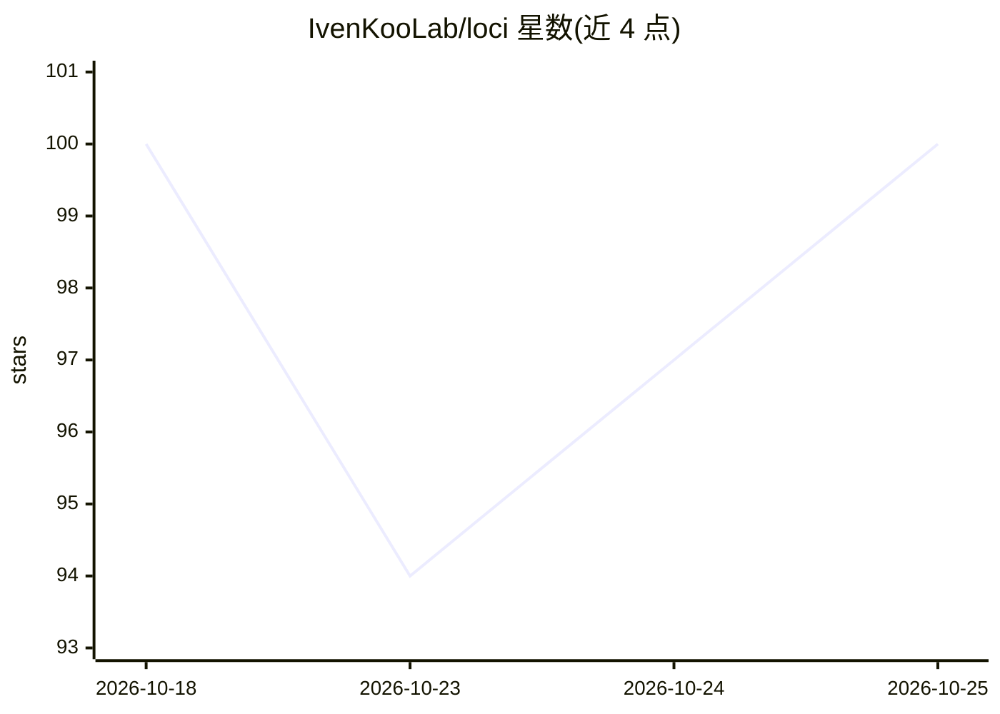

# IvenKooLab/loci

⭐ 100 · Python · MIT · 推送 2026-10-22 · [GitHub](https://github.com/IvenKooLab/loci) · 组织维护 · 中文 README

**AI 编码工具共享记忆库：本地混合检索与带引用问答**

将笔记、项目文档与 agent 记忆整合为可检索、可问答的本地知识库。检索采用向量+BM25 混合方式，回答附带 file>section 引用，可选逐条声明核验；数据与索引留在本机，嵌入与对话请求发送到用户配置的 provider，本地端点可全离线。支持 Markdown/text/HTML/org-mode 及聊天导出，可选 PDF/Word/OCR；通过 MCP 工具（brain_search/brain_ask/brain_remember 等 10 个）与 HTTP 服务让多个 AI 客户端共享同一实例，内置 Web 控制台，并提供 harness 记忆发现、agent 记忆统计。需 Python 3.11+，MIT 许可。

## 筛选速览

| 维度 | 判定 | 备注 |
|---|---|---|
| AI 角色 | `ai-ecosystem` | LLM/agent 周边工具 |
| 许可风险 | `permissive` | MIT |
| 部署形态 | `library` | 以包/库形式分发 |
| 模型依赖 | — | README 未给出锁定关系 |
| 硬件要求 | — | 无带数字的原话,不猜 |
| 安装摩擦 | `low` | 无编译、无系统依赖或容器化 |
| 成熟度 | — | 结构信号不足 |

## 能力要点

- 向量+BM25 混合检索，回答带 file>section 引用与可选声明核验
- 10 个 MCP 工具共享同一 LOCI_HOME 实例，跨 AI 客户端共享索引与记忆
- 内置 Web 控制台（搜索/问答/记忆/索引/审计，中英双语、明暗主题）
- 本地索引与文件，本地端点可全离线；增量索引，记忆以 Markdown 持久化

## 适用场景

- 让多个 AI 编码工具共享同一份项目知识与记忆
- 在笔记与项目文档中做带引用的可溯源问答
- 检查各 coding agent 各自记住了什么并统一管理
- 在 Obsidian 等现有笔记目录上建立可检索知识库

## 场景标签

`Agent 记忆` `知识库管理` `RAG` · 领域:Agent 开发

## 证据(README 行号)

> L12: loci combines vector search with BM25 and returns answers with `file > section` citations. Your files and index sta
> L30: |Carry context between AI tools|MCP tools share one instance; durable memories are Markdown files|
> L73: Point each MCP client at the **same `LOCI_HOME`** so they share the same config, index and memory files:

## 星数曲线

2026-10-18 100 → 2026-10-25 100（+0）

---
*卡片 v1 · prompt 1.4 · 生成 2026-10-23 · 置信度 high · 依据 README sha `5934395e9143` · [字段定义](../../DATASET.md)*
