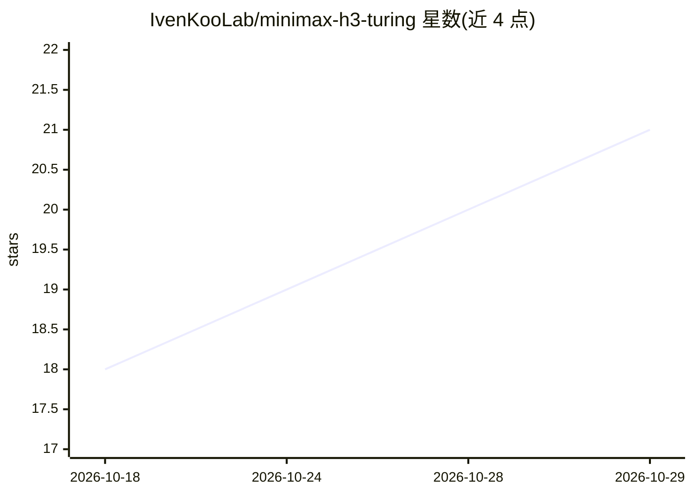

# IvenKooLab/minimax-h3-turing

⭐ 21 · Python · MIT · 推送 2026-10-22 · [GitHub](https://github.com/IvenKooLab/minimax-h3-turing) · 组织维护 · 中文 README

**在 2080Ti（Turing）上本地运行 MiniMax H3 视频生成的实测手册与工作流套件**

面向在 Turing（sm_75）显卡上本地运行 MiniMax H3 视频生成的实测手册：覆盖量化路线判定（W4A8）、启动参数与 13 条 FAQ、多条加速路线的结论表（SageAttention/TE-Speed 排除、T8 BlockCache、PDD LoRA 回移植），并提供六个可直接导入 ComfyUI 的工作流和一个零依赖的 Python 库 h3-turing（分层预设、ComfyUI 客户端、A/B 基准脚本）。所有结论来自 2080Ti 22G 改装卡上的真实生产管线；PDD/T8 分层曾因 pip 环境污染暂时下架待修复。

## 筛选速览

| 维度 | 判定 | 备注 |
|---|---|---|
| AI 角色 | `ai-knowledge` | 知识聚合/清单类 |
| 许可风险 | `permissive` | MIT |
| 部署形态 | `None` |  |
| 模型依赖 | — | README 未给出锁定关系 |
| 硬件要求 | — | 无带数字的原话,不猜 |
| 安装摩擦 | `medium` | 含编译或系统依赖之一 |
| 成熟度 | — | 结构信号不足 |

## 能力要点

- 六个实测验证的 ComfyUI 工作流（t2v/i2v × 终稿/快稿 + PDD）
- 零依赖 Python 库 h3-turing：分层预设、ComfyUI 客户端、A/B 基准
- 13 条实测 FAQ 与各加速路线的成/废结论表
- PDD LoRA 提前回移植：PDD+T8 组合 210 秒/片

## 适用场景

- 在 2080Ti 等 Turing 卡上把 H3 生成从 20-30 分钟压缩到几分钟
- 排查 ComfyUI 下 H3 的黑屏、OOM、同种子漂移等问题
- 判断哪些加速方案在自己卡上可行、哪些已被排除

## 场景标签

`视频生成` `模型量化` · 领域:内容生成

## 证据(README 行号)

> L7: **A field-tested handbook for running MiniMax H3 local video generation on a 2080Ti 22G mod card (Turing / sm_75).**
> L19: - ✅ **Six ready-to-import workflows** (t2v/i2v, each with a final-shot tier and a T8 fast-draft tier, plus a PDD ul
> L20: - ✅ **The Python library `h3-turing`**: all of the above codified - six tier presets, a retry-disciplined ComfyUI c

## 星数曲线

2026-10-18 18 → 2026-10-29 21（+3）

---
*卡片 v1 · prompt 1.4 · 生成 2026-10-28 · 置信度 high · 依据 README sha `9c14c5da3a89` · [字段定义](../../DATASET.md)*
