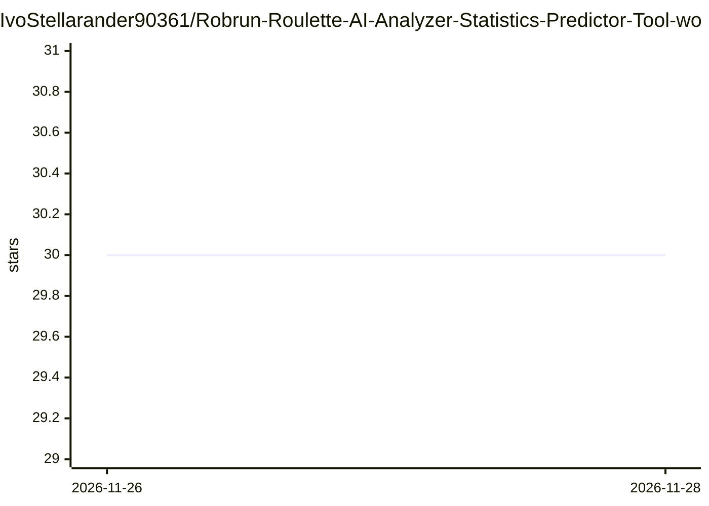

# IvoStellarander90361/Robrun-Roulette-AI-Analyzer-Statistics-Predictor-Tool-work

⭐ 30 · 推送 2026-11-24 · [GitHub](https://github.com/IvoStellarander90361/Robrun-Roulette-AI-Analyzer-Statistics-Predictor-Tool-work) · 个人维护

**面向 Robrun 轮盘玩家的 AI 模式分析与概率追踪工具**

README 内容极简：声称提供一款追踪轮盘走势、分析统计数据并预测号码的 AI 分析器，称由超过 2 万名玩家使用，包含神经模型与 99.6% 准确率等描述。仓库本身不含安装步骤、源码说明或技术文档，全部细节与下载入口指向外部第三方页面（vorza.top），无法从 README 验证其功能或运行方式。此类工具涉及对在线博彩游戏的预测/作弊用途，可信度存疑。

## 筛选速览

| 维度 | 判定 | 备注 |
|---|---|---|
| AI 角色 | `ai-native` | 本体是模型或模型工具 |
| 许可风险 | `none` | — |
| 部署形态 | `None` |  |
| 模型依赖 | — | README 未给出锁定关系 |
| 硬件要求 | — | 无带数字的原话,不猜 |
| 安装摩擦 | `low` | 无编译、无系统依赖或容器化 |
| 成熟度 | — | 结构信号不足 |

## 能力要点

- 宣称提供基于神经网络的轮盘概率趋势分析
- 宣称可监控近期开奖结果并追踪统计模式
- 下载与说明均在指向的外部页面获取

## 适用场景

- 查看 Robrun 轮盘的历史开奖统计与走势
- 按其宣称获取号码概率趋势分析

## 场景标签

 · 领域:游戏/分析工具

## 证据(README 行号)

> L3: Read how it works and download here:
> L12:  Full details, neural model overview, and **99.6%** accuracy stats are on the official page.

## 星数曲线

2026-11-26 30 → 2026-11-28 30（+0）

---
*卡片 v1 · prompt 1.4 · 生成 2026-11-26 · 置信度 low · 依据 README sha `47bc05aac521` · [字段定义](../../DATASET.md)*
