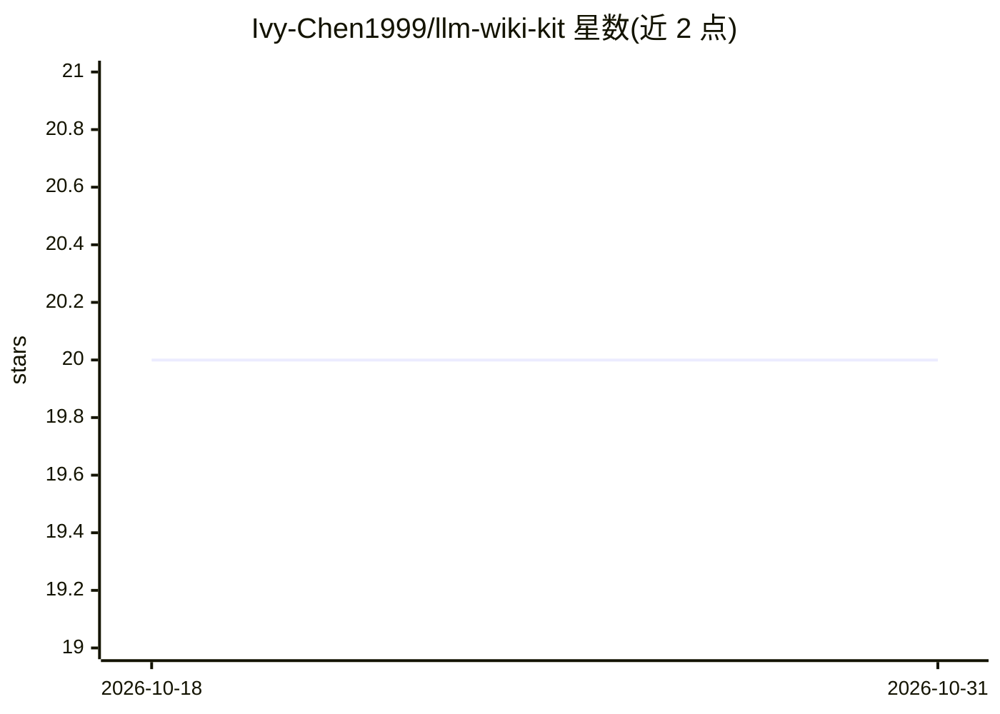

# Ivy-Chen1999/llm-wiki-kit

⭐ 20 · Shell · MIT · 推送 2026-07-07 · [GitHub](https://github.com/Ivy-Chen1999/llm-wiki-kit) · 个人维护

**个人知识库工具包：20 个 agent 技能加 Obsidian 起始 vault**

基于 Karpathy LLM Wiki 模式的个人维基维护套件：由 20 个 agent 技能文件和一个可复制的 Obsidian vault 模板组成。Agent 将文章、PDF、网页、Claude/Codex 对话历史等来源处理为带 YAML frontmatter 与 wikilinks 的结构化笔记，之后的问题回答基于这些笔记而非原始文档。需自备 Obsidian 与能加载技能目录的 agent（如 Claude Code、Claudian）；本地搜索引擎 qmd 为可选，缺省时回退到 Grep。git clone 后运行交互式 install.sh 完成安装。

## 筛选速览

| 维度 | 判定 | 备注 |
|---|---|---|
| AI 角色 | `ai-ecosystem` | LLM/agent 周边工具 |
| 许可风险 | `permissive` | MIT |
| 部署形态 | `library` | 以包/库形式分发 |
| 模型依赖 | — | README 未给出锁定关系 |
| 硬件要求 | — | 无带数字的原话,不猜 |
| 安装摩擦 | `low` | 无编译、无系统依赖或容器化 |
| 成熟度 | — | 结构信号不足 |

## 能力要点

- 20 个 agent 技能：摄取、查询、研究、更新、综合、交叉链接、lint、导出等
- 三层结构：原始来源（只读）+ 结构化笔记 vault + 技能指令文件
- 技能由自然语言触发，无需记忆技能名
- 支持多 vault：环境变量 / vault 根 .env / 全局配置三级解析

## 适用场景

- 把文章和网页一次性整理进个人 wiki，之后直接提问
- 把 Claude/Codex 对话历史归档为可检索笔记
- 让 agent 定期审计知识库（断链、孤儿笔记、过期内容）

## 场景标签

`知识库管理` · 领域:知识与检索

## 证据(README 行号)

> L3: A set of agent skills and a starter Obsidian vault for keeping a personal wiki that an LLM helps maintain. Based on 
> L52: - An agent that loads skills from a directory — Claudian (the Obsidian + Claude plugin), Claude Code, or similar.

## 星数曲线

2026-10-18 20 → 2026-10-31 20（+0）

---
*卡片 v1 · prompt 1.4 · 生成 2026-10-28 · 置信度 mid · 依据 README sha `afaf49a76f36` · [字段定义](../../DATASET.md)*
