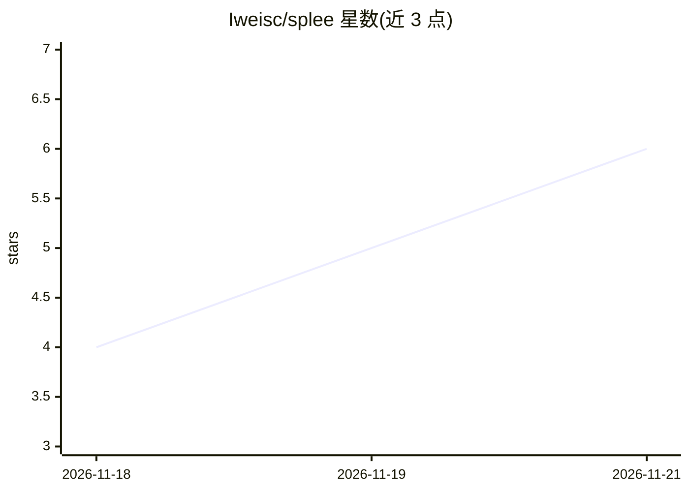

# Iweisc/splee

⭐ 6 · Rust · AGPL-3.0 · 推送 2026-11-20 · [GitHub](https://github.com/Iweisc/splee) · 个人维护

**自托管开源 AI SDR：找线索、写发个性化冷邮件并回复**

自托管的 AI 外销代理（AI SDR）与冷邮件平台：用户粘贴公司网站，代理调研公司、竞品与买家画像，在网络上查找匹配公司与决策人，从用户自己的 SMTP 邮箱在每日限额内发送个性化冷邮件，并经 IMAP 读取回复，将其分类为热门、提问、不感兴趣、退订等并起草答复与预约链接。还提供邮箱预热、跟进线程、A/B 测试、域名购买与 DNS 配置、网站访客识别、网站聊天与自动化规则，以 MCP server 供 Claude/ChatGPT 等客户端操作。AGPL 许可。

## 筛选速览

| 维度 | 判定 | 备注 |
|---|---|---|
| AI 角色 | `ai-native` | 本体是模型或模型工具 |
| 许可风险 | `viral` | AGPL-3.0 |
| 部署形态 | `self-host` | docker 或自建部署 |
| 模型依赖 | locked-api |  |
| 硬件要求 | — | 无带数字的原话,不猜 |
| 安装摩擦 | `low` | 无编译、无系统依赖或容器化 |
| 成熟度 | — | 结构信号不足 |

## 能力要点

- AI 代理完成找线索、写邮件、发送、回复分类的完整外销流程
- 多邮箱轮换、每日限额、邮件预热与 SPF/DKIM/DMARC 配置
- MCP server 支持 Claude、ChatGPT、Claude Code、Cursor 接入操作
- 32 种语言写作、每活动最多四个角度的 A/B 测试

## 适用场景

- 从自己的服务器和邮箱运行冷邮件外销活动
- 自动回复意向线索并附预约链接
- 识别网站访客所属公司并自动加入活动

## 场景标签

 · 领域:销售/营销自动化

## 证据(README 行号)

> L17: Splee is a free, open-source AI SDR (an AI outbound agent) that you host yourself, modelled on explee.com. You past
> L31: **Does it work from Claude, ChatGPT, Claude Code or Cursor?** Yes. Splee's MCP server lets you search companies, st

## 星数曲线

2026-11-18 4 → 2026-11-21 6（+2）

---
*卡片 v1 · prompt 1.4 · 生成 2026-11-21 · 置信度 mid · 依据 README sha `083434ae95e2` · [字段定义](../../DATASET.md)*
