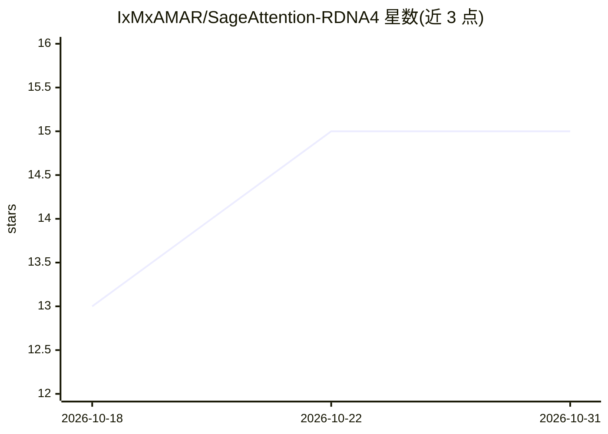

# IxMxAMAR/SageAttention-RDNA4

⭐ 15 · Python · Apache-2.0 · 推送 2026-10-28 · [GitHub](https://github.com/IxMxAMAR/SageAttention-RDNA4) · 个人维护

**面向 AMD RDNA4（RX 9070）的手写 HIP 量化注意力内核包**

sageattention 包的 drop-in 替换构建：底层为 SageAttention 2.2 与其 PR #368 的 gfx12 移植，上层加入手写 HIP 注意力内核，覆盖 head_dim 128 的 fp16/bf16 常见场景，fp16 的 Q·K 以每 token 单 scale 的 int8 计算，bf16 以 fp8 计算；v0.4.0 起量化前置步骤也预编译为 HIP 代码对象，运行时无需编译器。面向在 Windows/Linux 上使用 RX 9070/9070 XT（gfx1201）跑图像/视频模型的用户；ComfyUI 经 --use-sage-attention 开关直接使用。预编译 wheel 仅限指定 PyTorch ROCm 版本，其他版本需源码构建；不满足条件时回退到 PR #368 内核。

## 筛选速览

| 维度 | 判定 | 备注 |
|---|---|---|
| AI 角色 | `ai-ecosystem` | LLM/agent 周边工具 |
| 许可风险 | `permissive` | Apache-2.0 |
| 部署形态 | `library` | 以包/库形式分发 |
| 模型依赖 | — | README 未给出锁定关系 |
| 硬件要求 | — | 无带数字的原话,不猜 |
| 安装摩擦 | `low` | 无编译、无系统依赖或容器化 |
| 成熟度 | — | 结构信号不足 |

## 能力要点

- 手写 HIP 注意力内核覆盖 head_dim 128 的 fp16/bf16 场景
- fp16 Q·K 用每 token 单 scale 的 int8，bf16 用 fp8
- v0.4.0 量化前置预编译，运行时无需编译器
- ComfyUI 经 --use-sage-attention 直接使用，无需代码改动

## 适用场景

- 在 RX 9070/9070 XT 上为 ComfyUI 图像/视频渲染加速注意力计算
- 视频模型的长序列注意力（含 MiniMax H3 的 fused-QKV 布局）
- 替换 sageattention 包获得 per-token 量化精度的注意力输出

## 场景标签

`模型量化` `推理引擎` · 领域:训练与推理

## 证据(README 行号)

> L6: This is a drop-in build of the `sageattention` package. Underneath it is SageAttention 2.2 and the
> L18: ComfyUI users get it through the normal `--use-sage-attention` switch. No node and no code change
> L197: out = sageattn(q, k, v, tensor_layout="HND", is_causal=False)   # q, k, v: (B, H, N, D)

## 星数曲线

2026-10-18 13 → 2026-10-31 15（+2）

---
*卡片 v1 · prompt 1.4 · 生成 2026-10-30 · 置信度 high · 依据 README sha `8a2187dc292b` · [字段定义](../../DATASET.md)*
