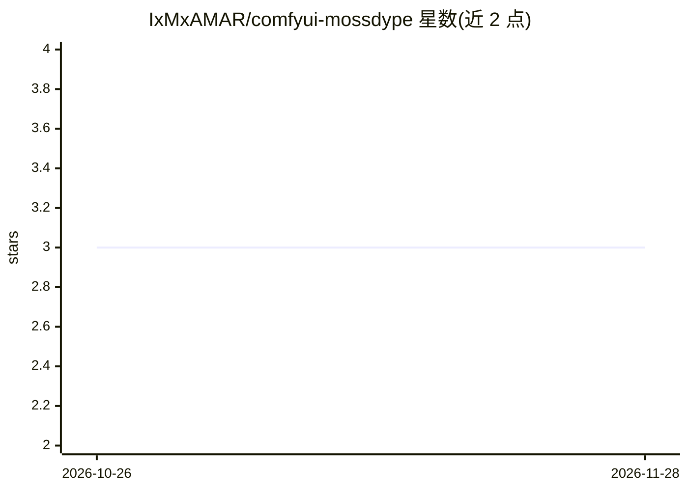

# IxMxAMAR/comfyui-mossdype

⭐ 3 · Python · MIT · 推送 2026-10-18 · [GitHub](https://github.com/IxMxAMAR/comfyui-mossdype) · 个人维护

**ComfyUI 节点：让 MOSS-Image 渲染超出 4MP 训练分辨率**

将 DyPE（arXiv 2510.20766）动态位置外推移植到 MOSS-Image 的 4 轴旋转编码的 ComfyUI 自定义节点，无需重训练即可让模型渲染远超约 4MP 训练范围，额外耗时约 0.5%。提供三个节点：MODEL 补丁（核心）、κ 调度表打印、分辨率换算。移植过程中发现并修复两个几何 bug（分轴缩放畸变、强度随分辨率增长），并对参考公式做三处修正。基线分辨率内补丁为 no-op，可常驻接线。

## 筛选速览

| 维度 | 判定 | 备注 |
|---|---|---|
| AI 角色 | `ai-native` | 本体是模型或模型工具 |
| 许可风险 | `permissive` | MIT |
| 部署形态 | `None` |  |
| 模型依赖 | — | README 未给出锁定关系 |
| 硬件要求 | — | 无带数字的原话,不猜 |
| 安装摩擦 | `low` | 无编译、无系统依赖或容器化 |
| 成熟度 | — | 结构信号不足 |

## 能力要点

- DyPE 移植到 MOSS-Image 4 轴旋转编码，无需重训练
- isotropic_scale 按像素面积统一缩放两轴，修复非方形画布畸变
- target_scale 直接锁定外推强度，跨输出尺寸可迁移
- 基线分辨率内为 no-op，enabled=false 时与无节点字节一致

## 适用场景

- 用 MOSS-Image 生成超过 4MP 的超高分辨率图像
- 调试不同 target_scale/schedule 配置对逐步外推的影响
- 将 DyPE 移植到其他模型时参考文中记录的两处缩放 bug

## 场景标签

`图像生成` · 领域:内容生成

## 证据(README 行号)

> L1: # MOSS-Image DyPE-M
> L3: Dynamic position extrapolation for MOSS-Image, so
> L26: - **MOSS-Image DyPE-M Patch** — MODEL in, MODEL out. This is the one you want.

## 星数曲线

2026-10-26 3 → 2026-11-28 3（+0）

---
*卡片 v1 · prompt 1.4 · 生成 2026-11-26 · 置信度 high · 依据 README sha `32a41f31e54a` · [字段定义](../../DATASET.md)*
