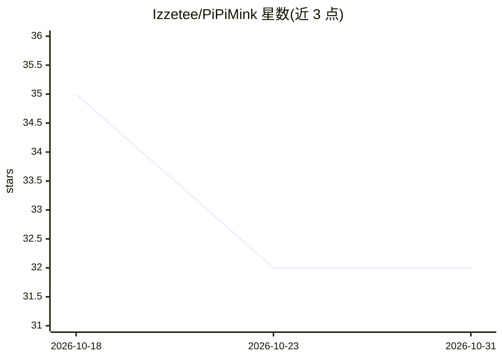

# Izzetee/PiPiMink

⭐ 32 · Go · Apache-2.0 · 推送 2026-10-23 · [GitHub](https://github.com/Izzetee/PiPiMink) · 个人维护

**按用户自建基准路由 prompt 到最适 LLM 的 Go 代理服务**

Go 编写的 LLM 路由代理服务：每个聊天请求先经可配置的 meta-model 做路由决策，再转发给选中的模型。路由依据三级信号：模型自报的能力标签（存于 PostgreSQL）、用户自定义基准得分（LLM judge 与确定性评分，覆盖编码/推理/创作等 7 类）、平均响应时间（仅作平局判定）。以 drop-in proxy 形式暴露 OpenAI 兼容与 Ollama 兼容端点，现有客户端无需改动；提供控制台 UI、OAuth2/OIDC 认证与 Prometheus 指标，依赖 PostgreSQL。

## 筛选速览

| 维度 | 判定 | 备注 |
|---|---|---|
| AI 角色 | `ai-ecosystem` | LLM/agent 周边工具 |
| 许可风险 | `permissive` | Apache-2.0 |
| 部署形态 | `self-host` | docker 或自建部署 |
| 模型依赖 | local-ok | 支持本地模型 |
| 硬件要求 | — | 无带数字的原话,不猜 |
| 安装摩擦 | `low` | 无编译、无系统依赖或容器化 |
| 成熟度 | — | 结构信号不足 |

## 能力要点

- meta-model 路由决策：能力标签 > 自定义基准分 > 响应时延（平局判定）
- 7 类内置基准，LLM judge 支持 1-5 级严格度与多准则 0-10 打分
- drop-in proxy 暴露 OpenAI/Ollama 兼容端点，现有客户端零改动
- 路由决策缓存（TTL+LRU）与 Prometheus 指标

## 适用场景

- 我有多个 LLM 提供商，想让每个 prompt 自动选最合适的模型
- 用自己工作流相关的任务给模型打分，替代通用排行榜
- 让 Open WebUI 等现有客户端接入一个统一入口自动路由

## 场景标签

`模型网关` · 领域:Agent 开发

## 证据(README 行号)

> L9: PiPiMink is a Go service that routes each prompt to the LLM most likely to produce the best response — **for you spe
> L98: PiPiMink is a drop-in proxy. Existing clients require no changes:
> L112: Clients like **Open WebUI** can connect directly using either the OpenAI-compatible or Ollama-compatible endpoint.

## 星数曲线

2026-10-18 35 → 2026-10-31 32（-3）

---
*卡片 v1 · prompt 1.4 · 生成 2026-10-26 · 置信度 high · 依据 README sha `c4b0019c8012` · [字段定义](../../DATASET.md)*
