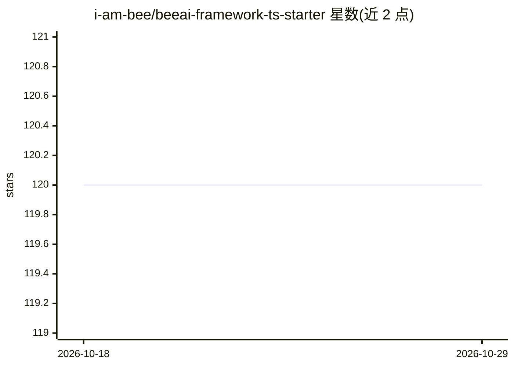

# i-am-bee/beeai-framework-ts-starter

⭐ 120 · TypeScript · 推送 2026-03-24 · [GitHub](https://github.com/i-am-bee/beeai-framework-ts-starter) · 组织维护

**BeeAI Framework 的 TypeScript 项目启动模板**

基于 Bee Agent Framework 的 TypeScript 起始模板：提供完整项目脚手架（linting/formatting），内置两个示例能力——通过 gRPC 服务安全执行任意 Python 代码的 Bee Code Interpreter，以及基于 OpenInference Instrumentation 的 agent 决策可观测性（可搭配 Phoenix 查看 spans）。要求 Node.js >18 与容器系统（Docker/Rancher/Podman），LLM 提供方可选外部 WatsonX/OpenAI/Groq 或本地 Ollama（默认）。面向希望快速上手 BeeAI Framework 的开发者。

## 筛选速览

| 维度 | 判定 | 备注 |
|---|---|---|
| AI 角色 | `ai-ecosystem` | LLM/agent 周边工具 |
| 许可风险 | `none` | — |
| 部署形态 | `self-host` | docker 或自建部署 |
| 模型依赖 | local-ok | 支持本地模型 |
| 硬件要求 | — | 无带数字的原话,不猜 |
| 安装摩擦 | `low` | 无编译、无系统依赖或容器化 |
| 成熟度 | — | 结构信号不足 |

## 能力要点

- Bee Agent Framework 的 TypeScript 项目模板（含 linting/formatting）
- gRPC 架构的 Code Interpreter 安全执行任意 Python 代码
- OpenInference Instrumentation 提供 agent 决策 spans 可观测性
- 默认 LLM 提供方为本地 Ollama，也可切换 WatsonX/OpenAI/Groq

## 适用场景

- 快速启动一个基于 BeeAI Framework 的 TypeScript agent 项目
- 让 agent 在沙箱中执行 Python 代码
- 通过 Phoenix 查看 agent 运行轨迹与决策过程

## 场景标签

`Agent 框架` · 领域:Agent 开发

## 证据(README 行号)

> L3: This starter template lets you quickly start working with the BeeAI Framework in a second.
> L9: - 🔒 Safely execute an arbitrary Python Code via Bee Code Interpreter.
> L10: - 🔎 Get complete visibility into agents' decisions using our OpenInference Instrumentation for BeeAI package.

## 星数曲线

2026-10-18 120 → 2026-10-29 120（+0）

---
*卡片 v1 · prompt 1.4 · 生成 2026-10-23 · 置信度 mid · 依据 README sha `8560ac2ab115` · [字段定义](../../DATASET.md)*
