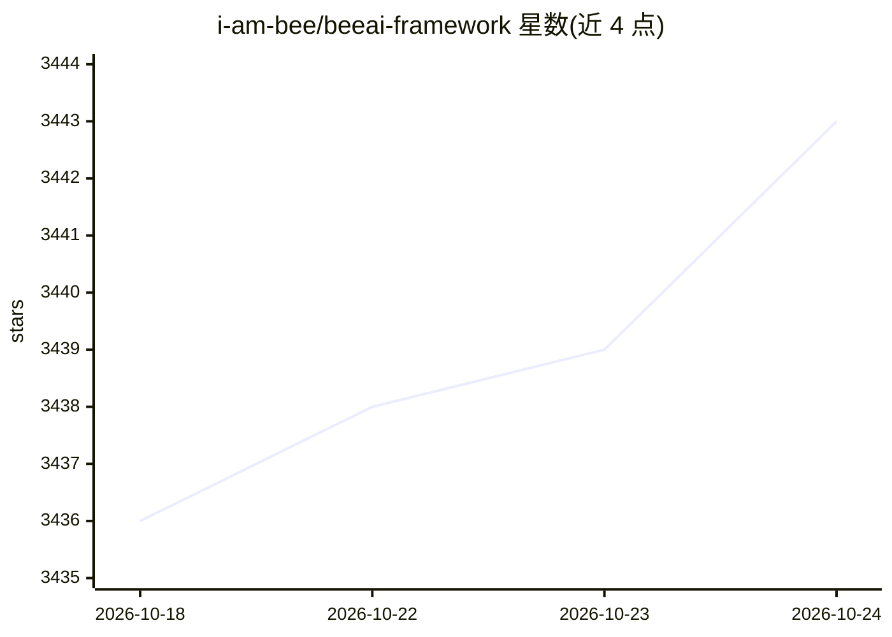

# i-am-bee/beeai-framework

⭐ 3,443 · Python · Apache-2.0 · 推送 2026-10-23 · [GitHub](https://github.com/i-am-bee/beeai-framework) · [官网](http://framework.beeai.dev) · 组织维护

**用 Python/TypeScript 构建多智能体系统的开源框架**

由 IBM 贡献、归属 LF AI & Data 的 Apache 2.0 框架，提供 Python 与 TypeScript 两个库，用于构建可推理、可执行动作的多智能体系统。能力覆盖统一接口接入任意 LLM 后端、内置与自定义工具、RAG（向量存储与文档处理）、模板化提示、记忆策略、缓存、序列化、事件与日志可观测性，以及通过 A2A/MCP 协议托管 agent。pip/npm 安装，示例可配合本地 ollama 模型运行。

## 筛选速览

| 维度 | 判定 | 备注 |
|---|---|---|
| AI 角色 | `ai-ecosystem` | LLM/agent 周边工具 |
| 许可风险 | `permissive` | Apache-2.0 |
| 部署形态 | `desktop` | 安装包/桌面程序 |
| 模型依赖 | local-ok | 支持本地模型 |
| 硬件要求 | — | 无带数字的原话,不猜 |
| 安装摩擦 | `low` | 无编译、无系统依赖或容器化 |
| 成熟度 | — | 结构信号不足 |

## 能力要点

- Python 与 TypeScript 双语言库
- Requirement Agent 按规则约束不同 LLM 的行为
- 支持 A2A、MCP、ACP 协议托管与集成
- RAG、记忆、缓存、序列化、可观测性等内置模块

## 适用场景

- 构建多智能体协作的工作流应用
- 通过统一接口切换不同 LLM 提供商
- 以 MCP/A2A 协议部署和暴露 agent 服务

## 场景标签

`多智能体` · 领域:Agent 开发

## 证据(README 行号)

> L31: BeeAI Framework is a comprehensive toolkit for building intelligent, autonomous agents and multi-agent systems. It 
> L42: |🔌 **Backend**|Connect to any LLM provider with unified interfaces|

## 星数曲线

2026-10-18 3,436 → 2026-10-24 3,443（+7）

---
*卡片 v1 · prompt 1.4 · 生成 2026-10-20 · 置信度 high · 依据 README sha `48c1194b1c4c` · [字段定义](../../DATASET.md)*
