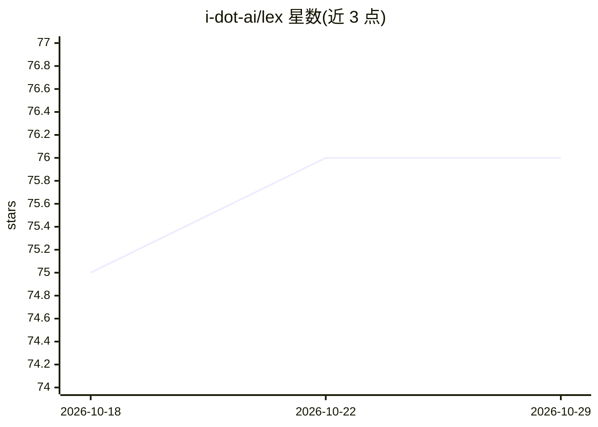

# i-dot-ai/lex

⭐ 76 · Python · MIT · 推送 2026-10-28 · [GitHub](https://github.com/i-dot-ai/lex) · [官网](https://lex.lab.i.ai.gov.uk/) · 组织维护

**英国立法数据 API：面向 AI agent 与法律研究者提供语义检索**

由 i-dot-ai 维护的英国法律数据服务，程序化访问 840 万+ 法律文档：22 万部法律与法规（1267 年至今，1963 年起完整）、89.2 万条修正案、8.9 万条解释性注释，以及暂缓上线的 7 万判例（待 TNA 许可）。提供混合语义检索，并通过 Model Context Protocol 接入 Claude Desktop、Claude Code、Cursor、Copilot 等客户端。本地开发需 Python 3.12+、uv、Docker 与 Azure OpenAI 凭据；README 声明为实验性服务，不建议作为生产依赖。

## 筛选速览

| 维度 | 判定 | 备注 |
|---|---|---|
| AI 角色 | `ai-knowledge` | 知识聚合/清单类 |
| 许可风险 | `permissive` | MIT |
| 部署形态 | `self-host` | docker 或自建部署 |
| 模型依赖 | locked-api |  |
| 硬件要求 | — | 无带数字的原话,不猜 |
| 安装摩擦 | `low` | 无编译、无系统依赖或容器化 |
| 成熟度 | `idea` | |

## 能力要点

- 8.4M+ UK 法律文档的混合语义检索 API
- MCP 集成，支持 Claude Desktop/Cursor/Copilot 等 5 种客户端接入
- 1963 年前历史立法经 AI 数字化（PDF Digitisation）
- 提供 make 命令的样本数据导入与本地运行流程

## 适用场景

- 为 AI 助手提供英国法律权威来源的 grounding 数据
- 法律研究者快速检索相关立法并追踪修正变化
- 政策分析中追踪立法随时间的演变

## 场景标签

`语义搜索` `科研工具` · 领域:知识与检索

## 证据(README 行号)

> L10: Lex provides programmatic access to 8.4M+ UK legal documents - legislation, amendments, and explanatory notes - wit
> L19: - **Case Law** - 70K judgments and 4.7M paragraphs (temporarily disabled pending TNA licence)

## 星数曲线

2026-10-18 75 → 2026-10-29 76（+1）

---
*卡片 v1 · prompt 1.4 · 生成 2026-10-24 · 置信度 mid · 依据 README sha `62883f98e240` · [字段定义](../../DATASET.md)*
