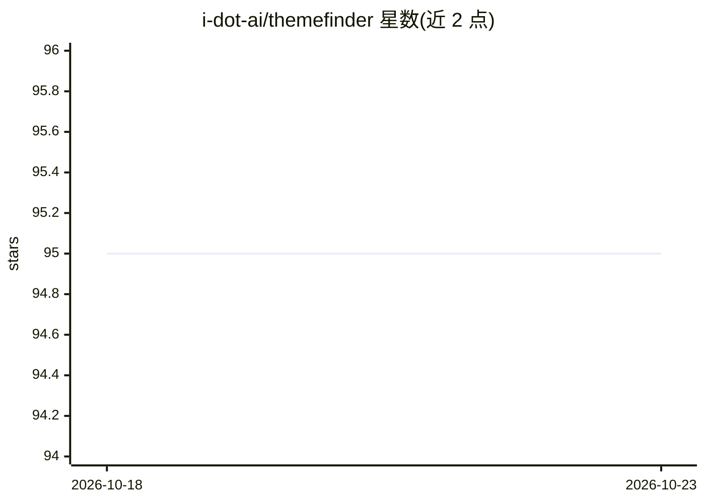

# i-dot-ai/themefinder

⭐ 95 · Python · MIT · 推送 2026-10-15 · [GitHub](https://github.com/i-dot-ai/themefinder) · [官网](https://i-dot-ai.github.io/themefinder/) · 组织维护

**分析一对多问答数据（问卷/公共咨询）的主题建模 Python 库**

输入为含 response_id 与 response 两列的 pandas DataFrame，find_themes 函数通过五个阶段的 LLM 流水线（情感分析、主题生成、主题凝练、主题精炼、主题映射，另有可选的主题数量对齐）对自由文本回复做主题识别、标签化与逐条映射，各阶段提示词位于 src/themefinder/prompts/。基于结构化输出机制兼容 OpenAI/Azure、Gemini、Claude、Llama、Mistral 等多类模型，环境变量经 LangChain 配置。面向问卷与公共咨询分析人员；README 自述为孵化期研究阶段项目，不建议用于关键场景。另附带咨询数据准备与 S3 上传的 Makefile 流程。

## 筛选速览

| 维度 | 判定 | 备注 |
|---|---|---|
| AI 角色 | `ai-native` | 本体是模型或模型工具 |
| 许可风险 | `permissive` | MIT |
| 部署形态 | `library` | 以包/库形式分发 |
| 模型依赖 | locked-api |  |
| 硬件要求 | — | 无带数字的原话,不猜 |
| 安装摩擦 | `low` | 无编译、无系统依赖或容器化 |
| 成熟度 | `idea` | |

## 能力要点

- 五阶段 LLM 流水线：情感分析→主题生成→凝练→精炼→逐条映射
- 支持多主题归属与可选的主题数量对齐
- 结构化输出方式兼容 OpenAI/Azure、Gemini、Claude、Llama、Mistral 等模型
- 提供 make setup-consultation 流程处理咨询数据并上传 S3

## 适用场景

- 分析问卷开放题回复中的共性主题
- 公共咨询（consultation）回复的主题归纳与逐条归类
- 结合情感分析对回复立场做结构化分类

## 场景标签

`数据分析` · 领域:效率与自动化

## 证据(README 行号)

> L3: ThemeFinder is a topic modelling Python package designed for analysing one-to-many question-answer data (i.e. survey
> L22: The function `find_themes` identifies common themes in responses and labels them, it also outputs results from inte
> L45: ## ThemeFinder pipeline

## 星数曲线

2026-10-18 95 → 2026-10-23 95（+0）

---
*卡片 v1 · prompt 1.4 · 生成 2026-10-23 · 置信度 high · 依据 README sha `93a69d481103` · [字段定义](../../DATASET.md)*
