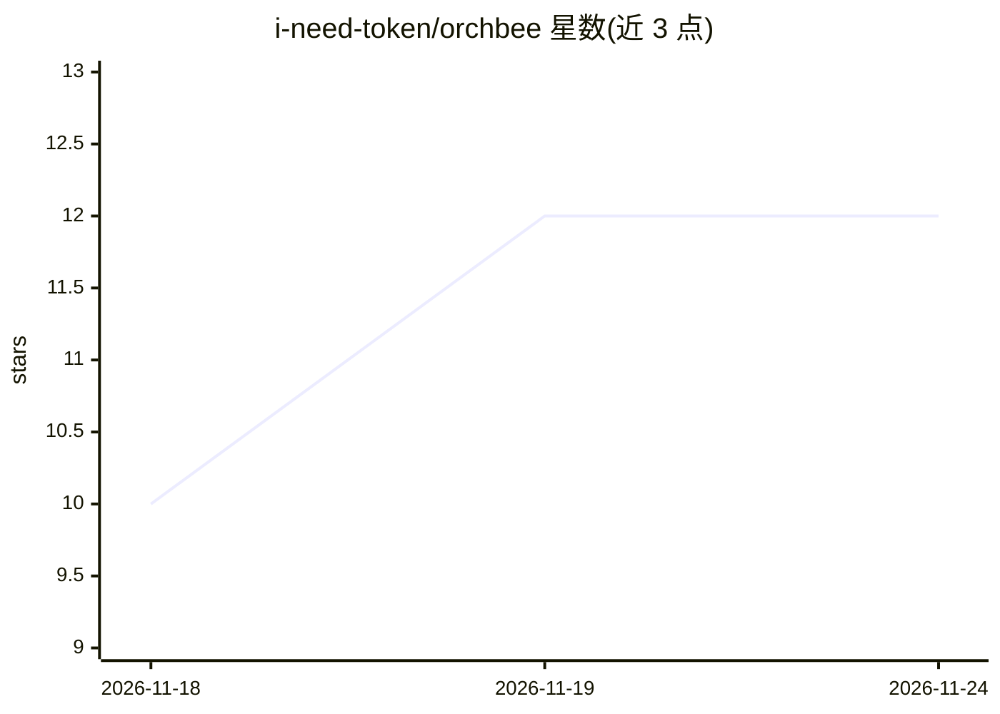

# i-need-token/orchbee

⭐ 13 · Rust · MIT · 推送 2026-11-24 · [GitHub](https://github.com/i-need-token/orchbee) · [官网](https://orchbee.com) · 个人维护 · 中文 README

**为运行与编排 AI agent CLI 提供的复用型终端**

基于 Ghostty 内核构建的现代终端，核心机制是会话多路复用：Session 在窗口关闭后于后台持续运行，可被终端界面、桌面应用和命令行多个客户端同时连接并实时同步。通过 orchbee CLI 提供对 agent 的启动、提示、等待、读取等操作，识别 30 余种 agent CLI 并展示状态，按项目/Workspace/Git worktree 组织。支持通过 SSH 添加远程机器（开发中）。目前为 beta，支持 Windows 11 x86_64 与 macOS 13+，Linux 构建进行中。

## 筛选速览

| 维度 | 判定 | 备注 |
|---|---|---|
| AI 角色 | `ai-ecosystem` | LLM/agent 周边工具 |
| 许可风险 | `permissive` | MIT |
| 部署形态 | `desktop` | 安装包/桌面程序 |
| 模型依赖 | — | README 未给出锁定关系 |
| 硬件要求 | — | 无带数字的原话,不猜 |
| 安装摩擦 | `low` | 无编译、无系统依赖或容器化 |
| 成熟度 | `idea` | |

## 能力要点

- 多路复用 Session：终端、桌面应用、CLI 同时连接同一会话
- orchbee 命令启动/提示/等待/读取 agent，支持 agent 间协作
- 识别 30 余种 agent CLI 并免配置展示状态
- 基于 Ghostty 内核，桌面端 WebGPU 渲染

## 适用场景

- 在多个终端面板中并行管理多个 coding agent
- 让 agent 互相提示、委派任务并读取彼此输出
- 从终端与桌面两端同时操控同一个后台会话

## 场景标签

`编码 Agent` · 领域:编码与开发

## 证据(README 行号)

> L3: **A modern, multiplexed terminal for running and orchestrating AI agents.**
> L17: **Its core is multiplexing.** A conventional terminal session ends when its window closes. An Orchbee Session persi
> L19: **This makes Orchbee a shared environment for people and agents.** Every operation available to a person is equally
> L26: > Orchbee does not replace your existing CLI agents; it provides the terminal environment in which they can work to

## 星数曲线

2026-11-18 10 → 2026-11-24 12（+2）

---
*卡片 v1 · prompt 1.4 · 生成 2026-11-19 · 置信度 high · 依据 README sha `5e367e07dd68` · [字段定义](../../DATASET.md)*
