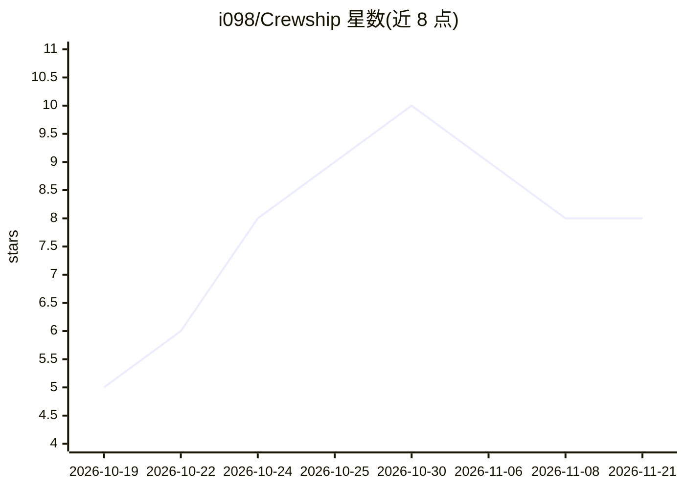

# i098/Crewship

⭐ 8 · TypeScript · NOASSERTION · 推送 2026-11-19 · [GitHub](https://github.com/i098/Crewship) · [官网](https://crewship.si) · 组织维护

**在一台 Ubuntu VPS 上自托管并行运行 AI 编码 agent 的工具包**

Crewship 把一台 Ubuntu 服务器配置为自托管的 AI 编码 agent 服务器：并行运行多个编码 agent，由 Firstmate 编排器监督，Herdr 侧边栏展示各工作区与 agent 状态。基于 Ansible playbook 提供主机供给，含守护规则（拦截 pkill、清理杂散容器）、内存消息板、凭据共享文件与可选的 Discord/Slack/iMessage 终端聊天客户端。要求 Ubuntu 24.04/26.04、至少 4 vCPU 与 16 GB RAM。许可证为 FSL-1.1（source-available），两年后转为 Apache-2.0。

## 筛选速览

| 维度 | 判定 | 备注 |
|---|---|---|
| AI 角色 | `ai-ecosystem` | LLM/agent 周边工具 |
| 许可风险 | `none` | NOASSERTION |
| 部署形态 | `library` | 以包/库形式分发 |
| 模型依赖 | — | README 未给出锁定关系 |
| 硬件要求 | — | 无带数字的原话,不猜 |
| 安装摩擦 | `low` | 无编译、无系统依赖或容器化 |
| 成熟度 | — | 结构信号不足 |

## 能力要点

- Firstmate 一个监督 agent 管理多个并行编码 agent
- Ansible playbook 供给主机，npm/bunx/curl 脚本一键安装
- Herdr 侧边栏展示工作区与 agent 状态和负载
- 可选 iMessage/Discord/Slack 终端聊天客户端与 Mac SSH 控制

## 适用场景

- 在自有 VPS 上并行运行多个 AI 编码 agent 处理长周期任务
- 通过手机或笔记本终端远程监督云端 agent 的工作
- 在服务器上集中管理 agent 的凭据与任务调度

## 场景标签

`编码 Agent` `多智能体` · 领域:Agent 开发

## 证据(README 行号)

> L13: Crewship helps you set up AI coding agents on a VPS.
> L14: It turns one Ubuntu server into a self-hosted AI coding agent server: you run parallel coding agents there, and Fir
> L71: - **Firstmate orchestration:** one supervisor agent runs many coding agents.

## 星数曲线

2026-10-19 5 → 2026-11-21 8（+3）

---
*卡片 v1 · prompt 1.4 · 生成 2026-11-20 · 置信度 high · 依据 README sha `fa23cfde8104` · [字段定义](../../DATASET.md)*
