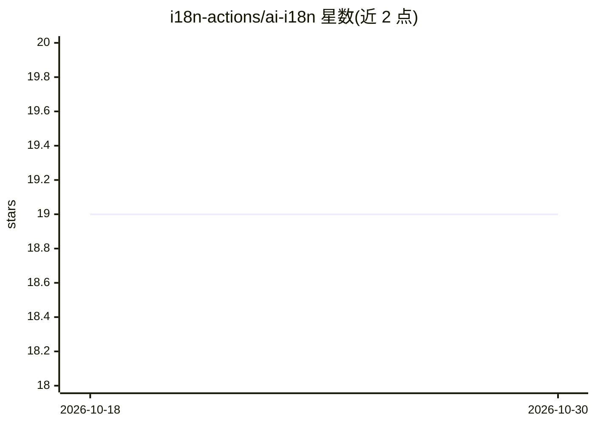

# i18n-actions/ai-i18n

⭐ 19 · TypeScript · 推送 2026-08-19 · [GitHub](https://github.com/i18n-actions/ai-i18n) · 组织维护

**GitHub Action：用 LLM 自动翻译应用的 i18n 文件并提交回仓库**

以 GitHub Action 形式运行的本地化翻译工具：在 push/commit/定时触发时读取 XLIFF 1.2/2.0 与 JSON（扁平/嵌套）格式文件，通过内容哈希检测变更，仅将新增或修改的字符串发送给 LLM 翻译，并把结果提交回仓库或生成 PR。支持 Anthropic、OpenAI、Ollama（自托管）与 AWS Bedrock Converse API 四种 provider。机制上保留 XLIFF 内联占位符、基于 CLDR 数据处理 20+ 语言的 ICU 复数规则，并跳过自身提交触发的运行以防止循环。面向在 CI 中自动化多语言翻译的开发团队，需 Node.js 20+ 用于本地开发。

## 筛选速览

| 维度 | 判定 | 备注 |
|---|---|---|
| AI 角色 | `ai-native` | 本体是模型或模型工具 |
| 许可风险 | `none` | — |
| 部署形态 | `library` | 以包/库形式分发 |
| 模型依赖 | local-ok | 支持本地模型 |
| 硬件要求 | — | 无带数字的原话,不猜 |
| 安装摩擦 | `low` | 无编译、无系统依赖或容器化 |
| 成熟度 | — | 结构信号不足 |

## 能力要点

- 内容哈希检测变更，仅翻译新增/修改字符串以控制成本
- XLIFF 内联元素以 {{MARKER}} 令牌送入 LLM 后重建为 XML
- 基于 CLDR 数据的 20+ 语言 ICU 复数规则处理
- 四种 provider：anthropic/openai/ollama/bedrock，Ollama 无需 API key

## 适用场景

- 每次 push 自动更新多语言翻译文件并生成 PR
- 用自托管 Ollama 在内网完成 i18n 翻译
- 预览翻译结果而不提交（dry-run 模式）

## 场景标签

`AI 写作` · 领域:内容生成

## 证据(README 行号)

> L3: **Automated i18n translation for GitHub workflows, powered by LLMs.**
> L5: Translate your app's localization files on every push. Drop in a GitHub Action, point it at your translation files, 
> L130: |`provider`|`anthropic`, `openai`, `ollama`, or `bedrock`|Yes|`anthropic`|

## 星数曲线

2026-10-18 19 → 2026-10-30 19（+0）

---
*卡片 v1 · prompt 1.4 · 生成 2026-10-29 · 置信度 high · 依据 README sha `51221d26cbab` · [字段定义](../../DATASET.md)*
