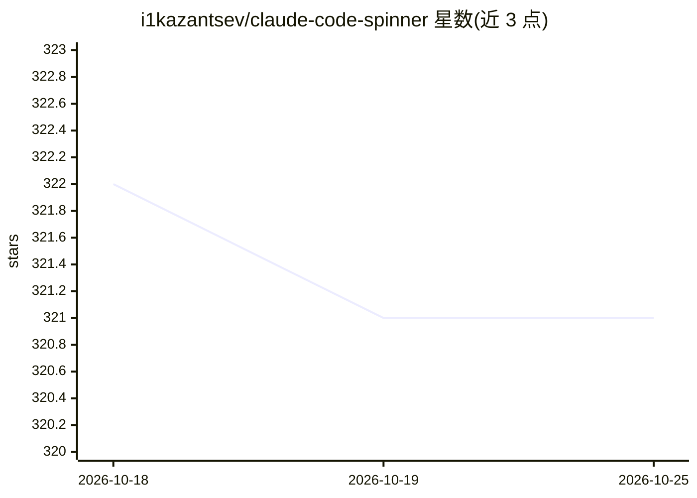

# i1kazantsev/claude-code-spinner

⭐ 320 · 推送 2026-05-06 · [GitHub](https://github.com/i1kazantsev/claude-code-spinner) · 个人维护

**替换 Claude Code 等待动画短语的个性化配置集（90+ 俄语短语）**

面向 Claude Code 用户的外观定制项目：用 90 余条俄语口语化短语（如“Обкашляю вопросик”）替换默认的 Thinking/Analyzing 等加载文案，通过 git clone 后在 Claude Code 内执行 /install-spinner 或手动将 spinners.json 内容合并进 ~/.claude/settings.json 完成；另提供 Stop 钩子，在 agent 回答结束时经 afplay（macOS 自带）播放提示音，可调节音量。作者声明仅 GitHub 本仓库为官方来源，已存在恶意副本。MIT 许可。

## 筛选速览

| 维度 | 判定 | 备注 |
|---|---|---|
| AI 角色 | `ai-ecosystem` | LLM/agent 周边工具 |
| 许可风险 | `none` | — |
| 部署形态 | `None` |  |
| 模型依赖 | — | README 未给出锁定关系 |
| 硬件要求 | — | 无带数字的原话,不猜 |
| 安装摩擦 | `low` | 无编译、无系统依赖或容器化 |
| 成熟度 | — | 结构信号不足 |

## 能力要点

- 90+ 条替换短语，mode 为 replace 直接覆盖默认 spinner 文案
- 提供 /install-spinner 与 /install-hook 命令行安装方式，也支持手动合并 settings.json
- Stop 钩子经 afplay 播放回答结束提示音，支持音量调节

## 适用场景

- 把 Claude Code 的英文等待短语换成俄语口语化文案
- 为 Claude Code 添加回答结束的提示音反馈
- 按个人喜好定制 Claude Code CLI 界面

## 场景标签

 · 领域:开发工具个性化

## 证据(README 行号)

> L7: Замена фраз спиннера Claude Code для уважаемых вайбкодеров.
> L9: Вместо стандартных `Thinking...`, `Analyzing...`, `Pondering...` будет крутиться **"Обкашляю вопросик"**, **"По крас

## 星数曲线

2026-10-18 322 → 2026-10-25 321（-1）

---
*卡片 v1 · prompt 1.4 · 生成 2026-10-21 · 置信度 high · 依据 README sha `37954e38d921` · [字段定义](../../DATASET.md)*
