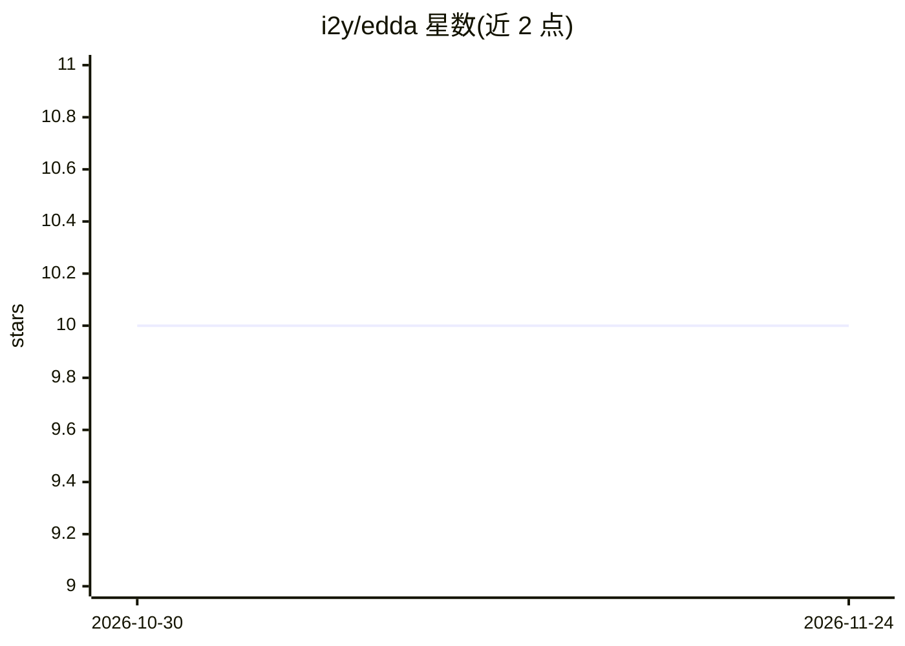

# i2y/edda

⭐ 10 · Python · MIT · 推送 2026-10-05 · [GitHub](https://github.com/i2y/edda) · [官网](https://i2y.github.io/edda/) · 个人维护

**Python 内嵌式持久化执行框架，让长流程在崩溃后自动恢复**

以库形式嵌入应用的持久化执行框架，无需独立 workflow server：通过确定性重放记录活动历史，进程崩溃后工作流从最后检查点自动恢复，已执行活动返回缓存结果。提供 Saga 模式自动补偿、活动指数退避重试（默认 5 次）、基于数据库锁的多 worker 协调、事务性 Outbox、事件/定时器等待，以及 MCP、Mirascope、LlamaIndex 等 AI 集成。需 Python 3.11+，状态存储于 SQLite/PostgreSQL/MySQL，多进程部署必须用后两者。

## 筛选速览

| 维度 | 判定 | 备注 |
|---|---|---|
| AI 角色 | `ai-enhanced` | 去掉 AI 部分产品仍成立 |
| 许可风险 | `permissive` | MIT |
| 部署形态 | `self-host` | docker 或自建部署 |
| 模型依赖 | — | README 未给出锁定关系 |
| 硬件要求 | — | 无带数字的原话,不猜 |
| 安装摩擦 | `low` | 无编译、无系统依赖或容器化 |
| 成熟度 | — | 结构信号不足 |

## 能力要点

- 确定性重放实现崩溃自动恢复，活动精确执行一次
- Saga 模式自动补偿与 @on_failure 装饰器
- 数据库锁多 worker 协调，无需 Redis/ZooKeeper
- MCP 集成可将持久化工作流暴露为 AI 工具

## 适用场景

- 订单处理、数据管道等需跨崩溃存活的长时间任务
- 微服务间分布式事务协调与回滚
- 多步骤 AI Agent 任务编排（LLM 调用、工具使用）
- 按时间或外部事件驱动的业务流程（提醒、续订）

## 场景标签

`工作流自动化` · 领域:效率与自动化

## 证据(README 行号)

> L5: > Lightweight durable execution framework - no separate server required
> L14: Edda is a lightweight durable execution framework for Python that runs as a **library** in your application - no se
> L33: - 🤖 **MCP Integration**: Expose durable workflows as AI tools via Model Context Protocol

## 星数曲线

2026-10-30 10 → 2026-11-24 10（+0）

---
*卡片 v1 · prompt 1.4 · 生成 2026-11-20 · 置信度 mid · 依据 README sha `83adf5c446ba` · [字段定义](../../DATASET.md)*
