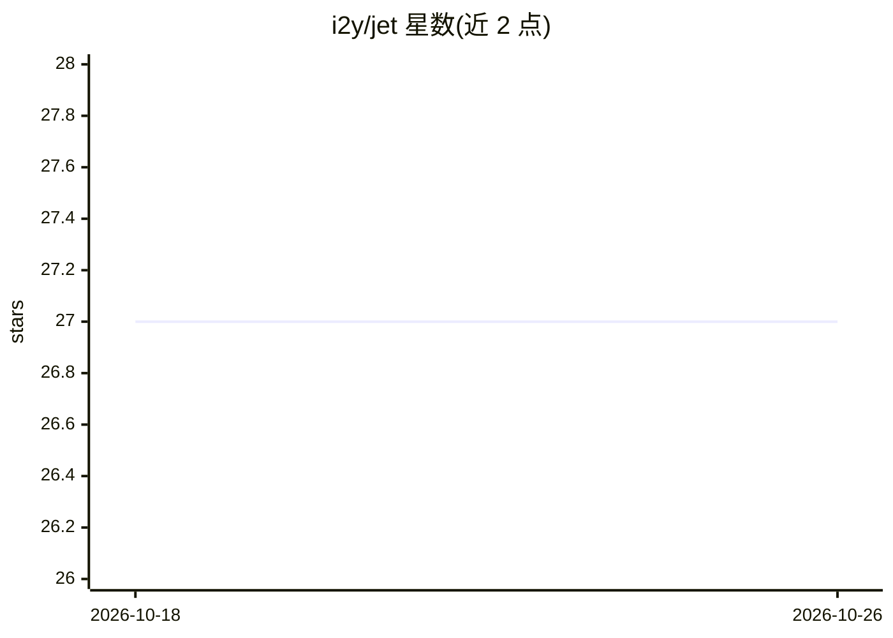

# i2y/jet

⭐ 27 · Gleam · MIT · 推送 2026-07-30 · [GitHub](https://github.com/i2y/jet) · 个人维护

**构建可监督 AI Agent 的 Ruby 风格 BEAM 编程语言**

运行于 Erlang VM（BEAM）的动态类型、Ruby 风格语言，核心抽象为 object = actor = agent：单个文件声明模型、角色与对外接口，经 `jet acp-serve` 作为 ACP agent 供编辑器内客户端驱动，或 `jet mcp-serve` 作为 MCP 服务器，亦可放入 console/agents/ 出现在 Web UI 中，保存时热加载重编译。Agent 由 OTP 监督：崩溃自动重启、支持万级 agent、跨 BEAM 节点分布式部署并在节点宕机后迁移。Runner 可插拔：进程内 LLM 调用（model 简写）、经 ACP 驱动外部编码 agent（Claude Code、Codex）或直接驱动 Claude CLI。声明式返回类型经 Schema-Aligned Parsing 修复模型输出，失败时报出具体字段。编译器用 Gleam 编写。

## 筛选速览

| 维度 | 判定 | 备注 |
|---|---|---|
| AI 角色 | `ai-ecosystem` | LLM/agent 周边工具 |
| 许可风险 | `permissive` | MIT |
| 部署形态 | `desktop` | 安装包/桌面程序 |
| 模型依赖 | local-ok | 支持本地模型 |
| 硬件要求 | — | 无带数字的原话,不猜 |
| 安装摩擦 | `low` | 无编译、无系统依赖或容器化 |
| 成熟度 | — | 结构信号不足 |

## 能力要点

- 单文件 agent 经 ACP/MCP 对外服务，OTP 监督崩溃恢复与跨节点迁移
- Schema-Aligned Parsing：按声明 schema 修复模型回复，代价计分，失败定位到字段
- runner 可插拔：进程内 LLM、ACP 外部 agent（Claude Code/Codex）、直接驱动 Claude CLI
- on_approval 权限门控统一覆盖外部 ACP 请求与原生工具调用

## 适用场景

- 在编辑器内通过 ACP 客户端驱动自建 agent 获得流式回答与工具调用
- 搭建大规模受监督的 agent 集群并跨机器分布运行
- 让 Claude Code/Codex 作为受监督 fleet 的成员被驱动

## 场景标签

`Agent 框架` · 领域:Agent 开发

## 证据(README 行号)

> L13: jet acp-serve sage::Sage::answer sage.jet

## 星数曲线

2026-10-18 27 → 2026-10-26 27（+0）

---
*卡片 v1 · prompt 1.4 · 生成 2026-10-26 · 置信度 mid · 依据 README sha `14c60fcccf1e` · [字段定义](../../DATASET.md)*
