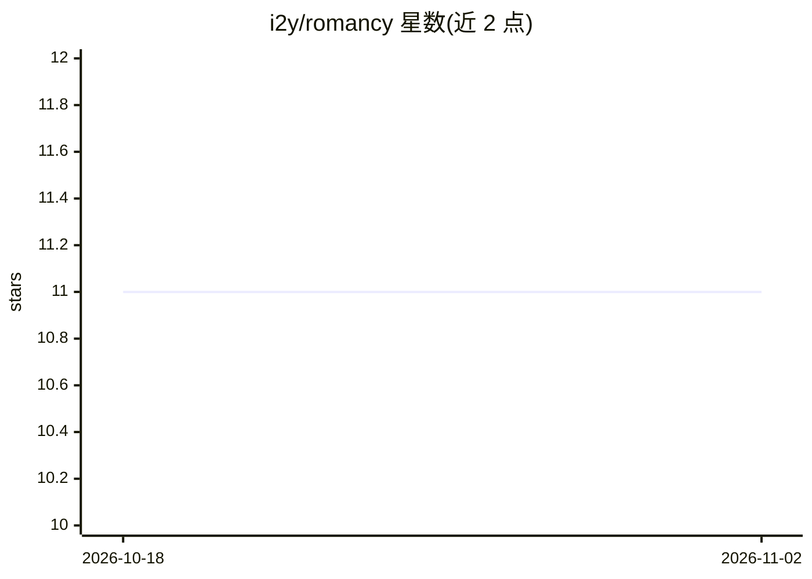

# i2y/romancy

⭐ 11 · Go · MIT · 推送 2026-04-26 · [GitHub](https://github.com/i2y/romancy) · [官网](https://i2y.github.io/romancy/) · 个人维护

**Go 语言持久化执行框架：让长流程在崩溃后自动恢复**

以库形式嵌入 Go 应用的持久化（durable）执行框架，无需独立工作流服务器：通过确定性重放工作流历史实现自动崩溃恢复，活动结果缓存保证恰好执行一次。支持 Saga 补偿、事务性 Outbox、CloudEvents、事件/定时器等待、工作流间 Channel 通信、Erlang 风格尾递归等；状态存储于 SQLite/PostgreSQL/MySQL（多副本部署需 PG/MySQL）。另提供 MCP 集成（将工作流暴露为 AI 助手工具）与经 bucephalus 的持久化 LLM 调用。为 Python 框架 Edda 的 Go 移植。

## 筛选速览

| 维度 | 判定 | 备注 |
|---|---|---|
| AI 角色 | `ai-ecosystem` | LLM/agent 周边工具 |
| 许可风险 | `permissive` | MIT |
| 部署形态 | `self-host` | docker 或自建部署 |
| 模型依赖 | — | README 未给出锁定关系 |
| 硬件要求 | — | 无带数字的原话,不猜 |
| 安装摩擦 | `low` | 无编译、无系统依赖或容器化 |
| 成熟度 | — | 结构信号不足 |

## 能力要点

- 确定性重放实现自动崩溃恢复，活动恰好执行一次
- Saga 补偿、事务性 Outbox、CloudEvents 原生支持
- 自动为注册工作流生成 4 个 MCP 工具（start/status/result/cancel）
- 经 bucephalus 支持持久化 LLM 调用（Anthropic/OpenAI/Gemini）

## 适用场景

- 订单处理、分布式事务（Saga）等需抗崩溃的长流程编排
- 多 Pod/容器间安全并发执行工作流
- 把业务工作流暴露为 MCP 工具供 AI 助手调用

## 场景标签

`工作流自动化` · 领域:效率与自动化

## 证据(README 行号)

> L31: - 🤖 **MCP Integration**: Expose workflows as MCP tools for AI assistants
> L311: Romancy provides durable LLM calls via the bucephalus library. All LLM calls are automatically cached as activitie
> L287: Romancy provides Model Context Protocol (MCP) integration, allowing you to expose workflows as MCP tools for AI as

## 星数曲线

2026-10-18 11 → 2026-11-02 11（+0）

---
*卡片 v1 · prompt 1.4 · 生成 2026-11-02 · 置信度 mid · 依据 README sha `3fc0c36874b7` · [字段定义](../../DATASET.md)*
