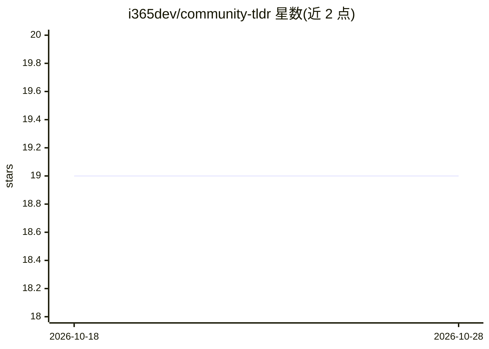

# i365dev/community-tldr

⭐ 19 · JavaScript · MIT · 推送 2026-02-05 · [GitHub](https://github.com/i365dev/community-tldr) · [官网](https://www.i365.tech/) · 个人维护 · 中文 README

**AI 摘要社区讨论的 Chrome 扩展（HN/Reddit/Quora）**

Chrome 浏览器扩展，对 Hacker News、Reddit、Quora 等社区长讨论生成 AI 摘要，支持全文摘要或单线程摘要，侧栏并排查看并可点击跳转原文。AI 后端可配置：自定义 API 端点、OpenAI、Anthropic Claude、Cloudflare AI Worker。摘要语言支持英/中/日/韩并可翻译。已上架 Chrome Web Store，也可源码构建后以未打包扩展加载。路线图含网页/邮件摘要与自托管 Web 版（均未实现）。

## 筛选速览

| 维度 | 判定 | 备注 |
|---|---|---|
| AI 角色 | `ai-native` | 本体是模型或模型工具 |
| 许可风险 | `permissive` | MIT |
| 部署形态 | `library` | 以包/库形式分发 |
| 模型依赖 | — | README 未给出锁定关系 |
| 硬件要求 | — | 无带数字的原话,不猜 |
| 安装摩擦 | `low` | 无编译、无系统依赖或容器化 |
| 成熟度 | — | 结构信号不足 |

## 能力要点

- 对 Hacker News/Reddit/Quora 讨论生成 AI 摘要
- 可配置 AI 后端（自定义端点/OpenAI/Anthropic/Cloudflare AI Worker）
- 英/中/日/韩四种摘要语言与内容翻译
- 不收集用户数据，设置仅本地存储

## 适用场景

- 浏览 Hacker News 或 Reddit 长讨论时快速获取要点
- 跨语言阅读社区讨论并生成中文摘要
- 用自己的 API 端点控制摘要生成后端

## 场景标签

`AI 写作` · 领域:内容生成

## 证据(README 行号)

> L3: A Chrome extension powered by AI to generate quick summaries of community discussions. Get insights from lengthy thr
> L9: - 🤖 AI-powered discussion summarization

## 星数曲线

2026-10-18 19 → 2026-10-28 19（+0）

---
*卡片 v1 · prompt 1.4 · 生成 2026-10-28 · 置信度 high · 依据 README sha `eabd76dc9e5a` · [字段定义](../../DATASET.md)*
