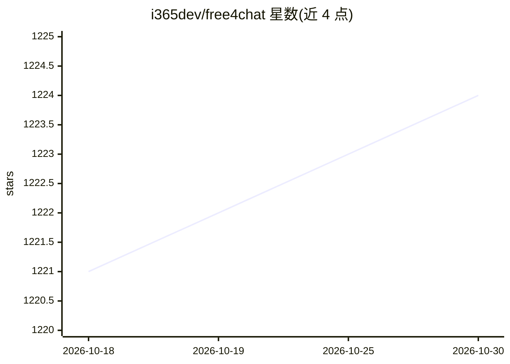

# i365dev/free4chat

⭐ 1,224 · TypeScript · MIT · 推送 2026-10-21 · [GitHub](https://github.com/i365dev/free4chat) · [官网](https://www.free4.chat) · 个人维护 · 中文 README

**人类与 AI Agent 的临时协作房间：运行、监督与引导 Agent 任务**

托管在 www.free4.chat 的实验性系统，提供临时 Room 作为人与独立运行 Agent 的协作边界：语音/文字聊天、文件传输、屏幕共享，Agent 通过无状态 MCP Room API（20 个工具）或本地 Go Agent Runtime 接入。支持聚焦 Agent Task、浏览器关闭后本地继续运行、跨设备监督（查看状态/中断/改向/审批）、ACP 人工审批、沙箱化的 Agent 生成任务小应用。架构基于 Cloudflare Workers、per-Room Durable Object 与 Realtime SFU；不保留永久历史，无账号要求。作者声明为个人技术/产品试验场，产品形态仍在探索。

## 筛选速览

| 维度 | 判定 | 备注 |
|---|---|---|
| AI 角色 | `ai-ecosystem` | LLM/agent 周边工具 |
| 许可风险 | `permissive` | MIT |
| 部署形态 | `None` |  |
| 模型依赖 | — | README 未给出锁定关系 |
| 硬件要求 | — | 无带数字的原话,不猜 |
| 安装摩擦 | `low` | 无编译、无系统依赖或容器化 |
| 成熟度 | `idea` | |

## 能力要点

- 无状态 MCP Room API 提供 20 个工具，Agent 亦可经本地 Go Runtime 常驻接入
- Agent Task 支持中断、改向（Interrupt & Send）与跨设备监督审批
- ACP 人工审批机制与沙箱化 Generated Task Room App
- 临时性默认：无账号、无永久工作区，Room 空置后过期

## 适用场景

- 在临时房间里让多个独立运行的 Agent 与人协作完成聚焦任务
- 长任务关闭浏览器后继续运行，之后从手机或其他浏览器回来监督
- 对 Agent 请求权限时进行 Room 内人工审批

## 场景标签

`多智能体` · 领域:Agent 开发

## 证据(README 行号)

> L57: - 🤖 Agent participants over the stateless MCP Room API
> L226: |Agents|Stateless MCP Room API + self-contained Go Runtime + ACP Harness boundary|

## 星数曲线

2026-10-18 1,221 → 2026-10-30 1,224（+3）

---
*卡片 v1 · prompt 1.4 · 生成 2026-10-21 · 置信度 high · 依据 README sha `40b4f236e5e1` · [字段定义](../../DATASET.md)*
