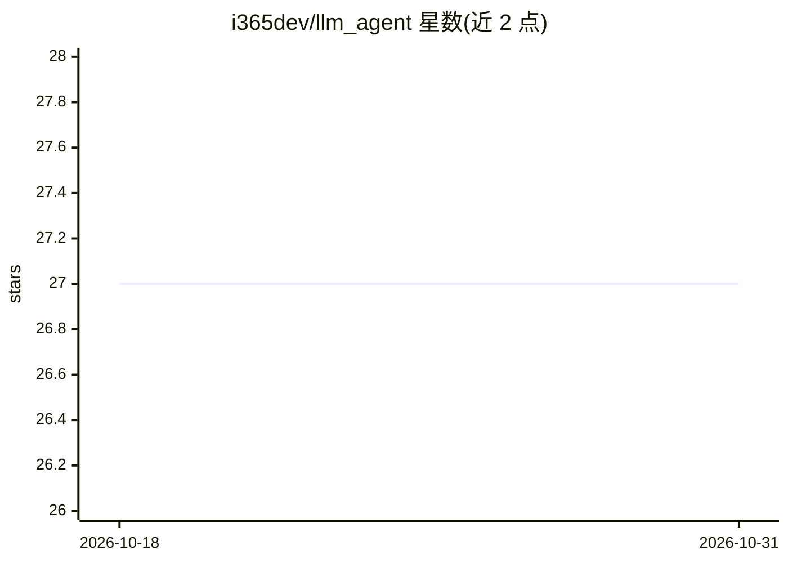

# i365dev/llm_agent

⭐ 27 · Elixir · MIT · 推送 2026-02-05 · [GitHub](https://github.com/i365dev/llm_agent) · [官网](https://www.myinvestpilot.com) · 个人维护

**基于 Elixir/AgentForge 的领域 LLM Agent 抽象库**

LLMAgent 是构建领域专用智能体的 Elixir 抽象库，基于 AgentForge 的信号驱动架构，提供预定义信号类型、消息与工具处理器、会话状态存储、标准流程组合与长任务管理。通过插件系统接入多家 LLM 提供商（README 示例展示 OpenAI completion 调用），并支持由 LLM 根据上下景动态编排多步工作流。开发者通过自定义 handler、工具、任务与 flow 构建领域 agent，示例含投资组合顾问 agent。以 Hex 包（mix.exs 依赖）安装，MIT 许可，由个人维护。

## 筛选速览

| 维度 | 判定 | 备注 |
|---|---|---|
| AI 角色 | `ai-ecosystem` | LLM/agent 周边工具 |
| 许可风险 | `permissive` | MIT |
| 部署形态 | `None` |  |
| 模型依赖 | — | README 未给出锁定关系 |
| 硬件要求 | — | 无带数字的原话,不猜 |
| 安装摩擦 | `low` | 无编译、无系统依赖或容器化 |
| 成熟度 | — | 结构信号不足 |

## 能力要点

- LLM 专用信号类型与消息/工具处理器
- 插件式 LLM 提供商接入（示例含 OpenAI completion）
- 会话状态存储与标准流程（conversation/qa_agent）
- LLM 依据上下文动态编排多步工作流

## 适用场景

- 用 Elixir 快速搭建带工具调用的对话 agent
- 构建领域专用 agent（如投资组合顾问）
- 需要长任务管理与多步工作流编排的 LLM 应用

## 场景标签

`Agent 框架` · 领域:Agent 开发

## 证据(README 行号)

> L8: LLMAgent is an abstraction library for building domain-specific intelligent agents based on Large Language Models (L
> L102: LLMAgent supports multiple LLM providers through its plugin system:

## 星数曲线

2026-10-18 27 → 2026-10-31 27（+0）

---
*卡片 v1 · prompt 1.4 · 生成 2026-10-26 · 置信度 high · 依据 README sha `b3b573e429a9` · [字段定义](../../DATASET.md)*
