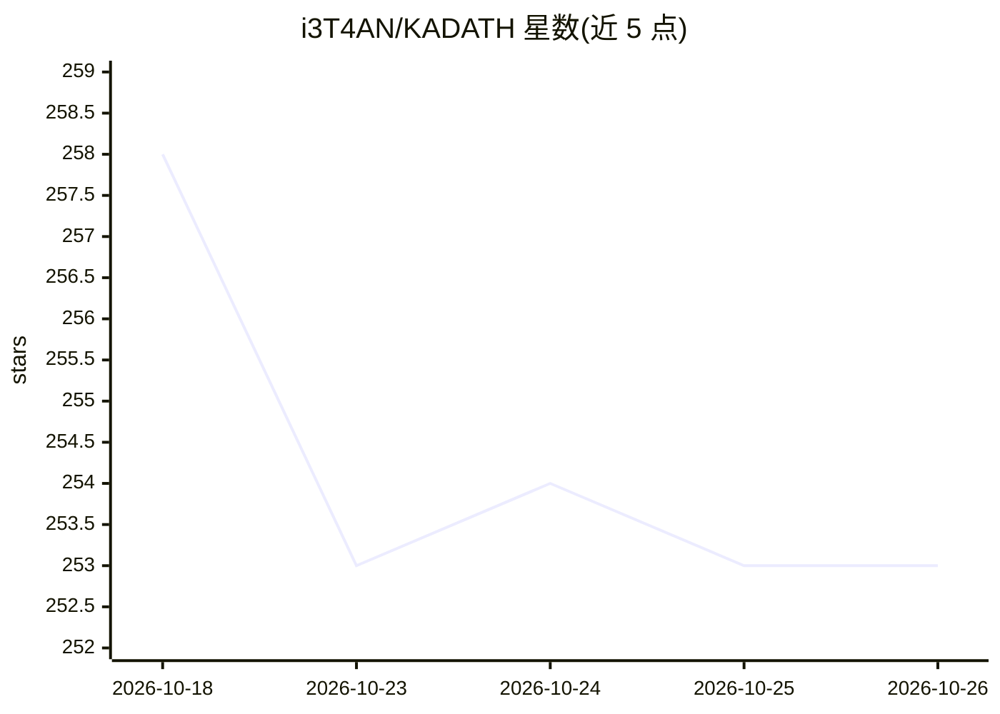

# i3T4AN/KADATH

⭐ 253 · Python · Apache-2.0 · 推送 2026-10-24 · [GitHub](https://github.com/i3T4AN/KADATH) · 个人维护

**演化式多智能体运行时：通过世代竞争与选择自动优化 agent**

面向希望自动改进 agent 的开发者：给定目标后，由 Architect 模型生成机器可读基准并锁定，种群中的每个 agent（完整可演化框架：系统提示、Python 实现、工具、依赖）在容器中隔离执行、按核内公式评分，再经变异、繁殖与淘汰逐代迭代。内核掌管调度、容器、证据冻结、Git 谱系与评分，不可被 agent 改写。以 ./kadath.sh 交互式终端启动，首次启动配置 OpenAI API key 并本地生成 PostgreSQL/MinIO/LiteLLM/SearXNG 服务，依赖 Docker 运行时。演示运行中最佳适应度从 18 升至 91。

## 筛选速览

| 维度 | 判定 | 备注 |
|---|---|---|
| AI 角色 | `ai-ecosystem` | LLM/agent 周边工具 |
| 许可风险 | `permissive` | Apache-2.0 |
| 部署形态 | `self-host` | docker 或自建部署 |
| 模型依赖 | — | README 未给出锁定关系 |
| 硬件要求 | — | 无带数字的原话,不猜 |
| 安装摩擦 | `low` | 无编译、无系统依赖或容器化 |
| 成熟度 | — | 结构信号不足 |

## 能力要点

- 基因组含完整可编辑 agent 框架（提示词、代码、工具、依赖）
- Architect 生成满足严格契约的可锁存基准，审批后哈希锁定
- 证据冻结边界与核内公式评分，忽略 agent 自评
- 内核/生物体双层隔离，agent 无法改写评分与谱系

## 适用场景

- 给定目标自动演化出更优的自主 agent
- 以可复现、防作弊的基准对 agent 种群做世代评测
- 研究多 agent 竞争选择与谱系管理机制

## 场景标签

`Agent 框架` `多智能体` `模型评测` · 领域:Agent 开发

## 证据(README 行号)

> L5: KADATH takes a goal and spends an ungodly number of model tokens evolving agents that are progressively better at ac
> L17: - The **kernel** owns the run, benchmark, deadlines, containers, evidence, grading formulas, population selection, 

## 星数曲线

2026-10-18 258 → 2026-10-26 253（-5）

---
*卡片 v1 · prompt 1.4 · 生成 2026-10-22 · 置信度 mid · 依据 README sha `6bf8032f9e74` · [字段定义](../../DATASET.md)*
