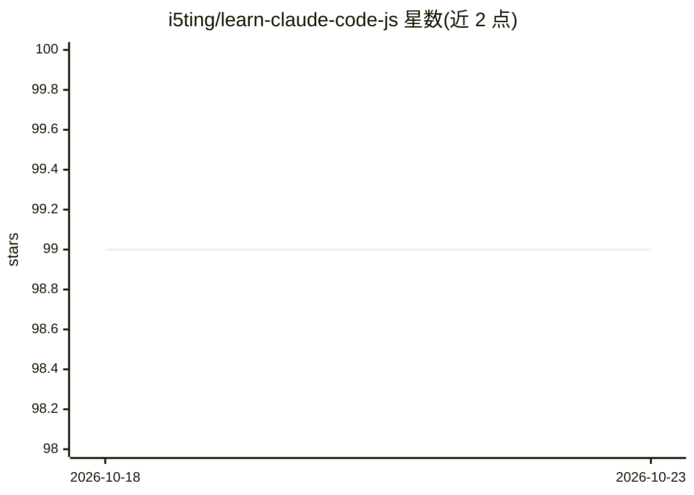

# i5ting/learn-claude-code-js

⭐ 99 · JavaScript · 推送 2026-03-15 · [GitHub](https://github.com/i5ting/learn-claude-code-js) · [官网](https://learn.shareai.run/zh/) · 个人维护 · 中文 README

**Node.js 版 Claude Code 原理学习课程（12 课）**

从 Python 版 learn-claude-code 迁移为 Node.js 技术栈的学习型项目：通过 12 个递进式课程（s01-s12）从零构建 nano Claude Code-like agent，覆盖 Agent 循环、TodoWrite、子智能体、上下文压缩、任务系统、智能体团队与 worktree 隔离等机制，每课叠加一个机制且主循环不变。自述为 0->1 学习项目，有意省略事件总线、权限治理、会话生命周期等生产机制。提供源码运行方式与 Web 可视化平台（localhost:3000）。

## 筛选速览

| 维度 | 判定 | 备注 |
|---|---|---|
| AI 角色 | `ai-knowledge` | 知识聚合/清单类 |
| 许可风险 | `none` | — |
| 部署形态 | `library` | 以包/库形式分发 |
| 模型依赖 | — | README 未给出锁定关系 |
| 硬件要求 | — | 无带数字的原话,不猜 |
| 安装摩擦 | `low` | 无编译、无系统依赖或容器化 |
| 成熟度 | — | 结构信号不足 |

## 能力要点

- 12 个递进式课程，从 Agent 循环到多 agent 协作与 worktree 隔离
- src 从原 Python 版 agents 目录直接迁移，仅新增 client.js
- Web 平台提供交互式可视化、分步动画与源码查看器
- 明确范围说明：省略 Hook 总线、权限治理、完整 MCP 运行时等生产机制

## 适用场景

- 用 Node.js 技术栈从零理解 Claude Code 类 agent 的工作原理
- 按课程逐个学习子智能体、上下文压缩、多 agent 协作等机制
- 对照 Python 参考实现练习 JS 版 agent 构建

## 场景标签

`教程课程` `多智能体` · 领域:Agent 开发

## 证据(README 行号)

> L3: 学习claude-code推荐路径
> L116: 本仓库是一个 0->1 的学习型项目，用于从零构建 nano Claude Code-like agent。
> L65: **12 个递进式课程, 从简单循环到隔离化的自治执行。**

## 星数曲线

2026-10-18 99 → 2026-10-23 99（+0）

---
*卡片 v1 · prompt 1.4 · 生成 2026-10-23 · 置信度 high · 依据 README sha `ac90c0ba8aa1` · [字段定义](../../DATASET.md)*
