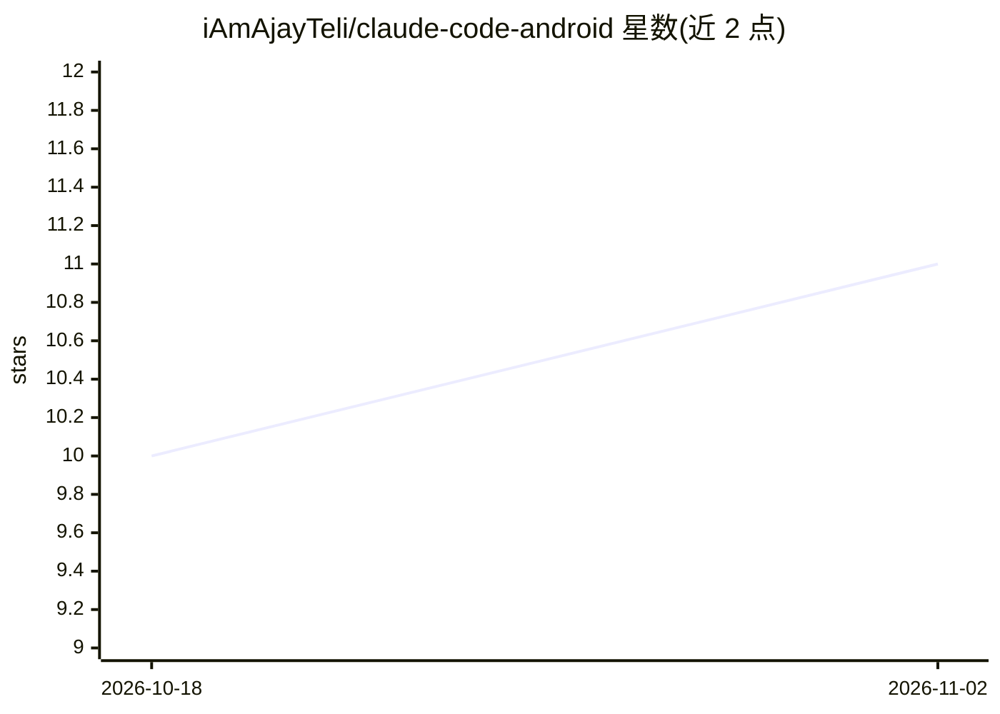

# iAmAjayTeli/claude-code-android

⭐ 11 · Shell · MIT · 推送 2026-08-02 · [GitHub](https://github.com/iAmAjayTeli/claude-code-android) · 个人维护

**在未 root 的 Android 手机上运行 Claude Code 的教程与脚本**

面向想在手机上使用 Claude Code 的用户的安装指南仓库：通过 Termux 安装 proot-distro 运行 Ubuntu 容器，在 Ubuntu 内用 Anthropic 官方安装器安装 Claude Code，并在 Termux 侧运行 9Router 代理（监听 127.0.0.1:20128），将请求转发到多个免费 provider 组成的 combo。提供 setup.sh 脚本自动完成前三步（Termux 包、Ubuntu、Claude Code），后续步骤（9Router、provider、settings.json）需手动完成。限制：需 aarch64 CPU、4GB 以上 RAM、约 5GB 存储，免费额度可能变动。

## 筛选速览

| 维度 | 判定 | 备注 |
|---|---|---|
| AI 角色 | `ai-knowledge` | 知识聚合/清单类 |
| 许可风险 | `permissive` | MIT |
| 部署形态 | `library` | 以包/库形式分发 |
| 模型依赖 | — | README 未给出锁定关系 |
| 硬件要求 | — | 无带数字的原话,不猜 |
| 安装摩擦 | `medium` | 含编译或系统依赖之一 |
| 成熟度 | — | 结构信号不足 |

## 能力要点

- setup.sh 脚本自动完成 Termux 包安装、Ubuntu 容器与 Claude Code 安装（前置检查、失败重试）
- 9Router 本地代理支持多免费 provider 按优先级组合（combo）故障转移
- README 区分 Termux 与 Ubuntu 两个 shell 环境并给出逐步命令
- 配套设置视频与 troubleshooting/free-api-options 文档

## 适用场景

- 在没有 PC 的情况下在 Android 手机上运行 Claude Code
- 通过 9Router 代理聚合免费模型额度供 Claude Code 使用
- 按章节手动搭建或用脚本快速完成 Termux + Ubuntu + Claude Code 环境

## 场景标签

`教程课程` · 领域:学习与行业

## 证据(README 行号)

> L3: **The real Claude Code, running on an unrooted phone. No PC, no root, no paid plan.**
> L5: Termux → proot-Ubuntu → Claude Code, with free model access through a local 9Router proxy.
> L66: `setup.sh` does Chapters 1–3 — Termux packages, Ubuntu, Claude Code — unattended:

## 星数曲线

2026-10-18 10 → 2026-11-02 11（+1）

---
*卡片 v1 · prompt 1.4 · 生成 2026-11-02 · 置信度 mid · 依据 README sha `8ba40a9c1f66` · [字段定义](../../DATASET.md)*
