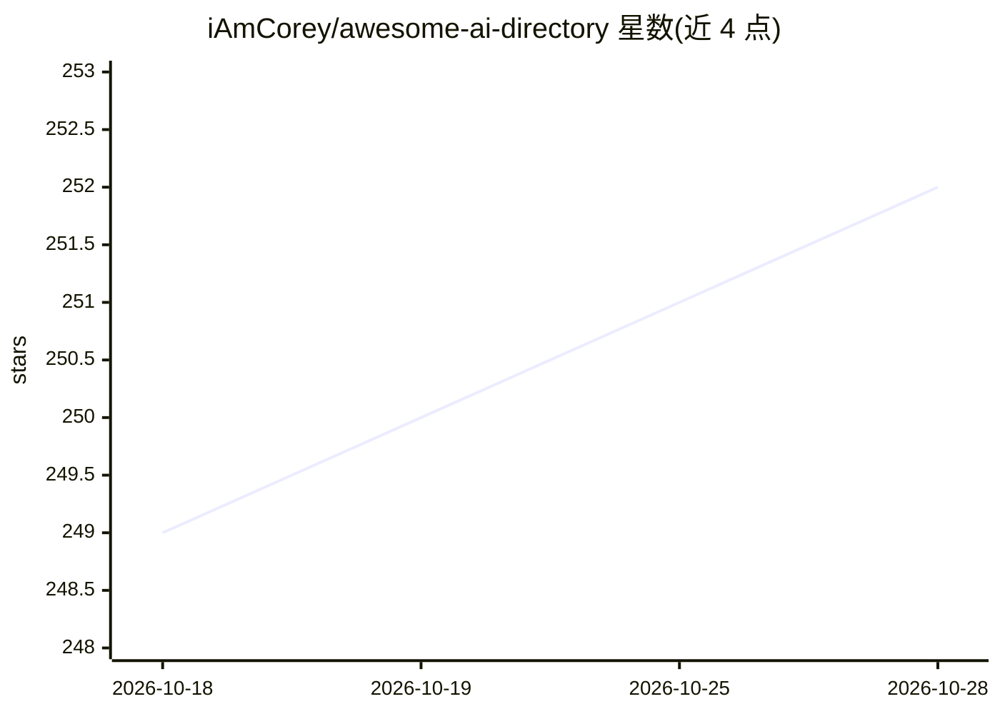

# iAmCorey/awesome-ai-directory

⭐ 252 · MIT · 推送 2026-02-27 · [GitHub](https://github.com/iAmCorey/awesome-ai-directory) · [官网](https://bestdirectories.org) · 个人维护 · 中文 README

**AI 工具导航站与学习资源聚合清单**

由个人维护的 awesome 类策展清单，收录各类 AI 资源网站，按四个板块组织：AI 工具收录导航（约 160 个导航站条目，含描述与 DR/MV 数据）、AI 模型接口资源（Openrouter、Replicate、DeepSeek 等）、AI 学习资料（Fast.ai、Kaggle、Coursera 等）与 AI 新闻趋势聚合（Product Hunt、Hacker News 等）。面向 AI 爱好者、开发者与研究人员提供资源查找渠道，也为导航站开发者提供收录渠道；通过 PR 和 Issue 接受社区提交。

## 筛选速览

| 维度 | 判定 | 备注 |
|---|---|---|
| AI 角色 | `ai-knowledge` | 知识聚合/清单类 |
| 许可风险 | `permissive` | MIT |
| 部署形态 | `None` |  |
| 模型依赖 | — | README 未给出锁定关系 |
| 硬件要求 | — | 无带数字的原话,不猜 |
| 安装摩擦 | `low` | 无编译、无系统依赖或容器化 |
| 成熟度 | — | 结构信号不足 |

## 能力要点

- 约 160 个 AI 工具导航站条目，附描述与 DR/MV 指标
- 四个板块覆盖工具导航、模型接口、学习资料与新闻趋势
- 通过 PR 和 Issue 接受社区提交，资源定期更新

## 适用场景

- 查找适合提交自己 AI 工具的导航站收录渠道
- 按板块浏览 AI 学习课程与模型 API 平台
- 跟踪 AI 新闻与趋势聚合站点

## 场景标签

`精选清单` · 领域:学习与行业

## 证据(README 行号)

> L3: 💡 收录优质AI工具导航及开发学习资源聚合平台
> L18: ## AI工具收录导航
> L183: ## AI模型接口资源

## 星数曲线

2026-10-18 249 → 2026-10-28 252（+3）

---
*卡片 v1 · prompt 1.4 · 生成 2026-10-22 · 置信度 high · 依据 README sha `02666cd3dee1` · [字段定义](../../DATASET.md)*
