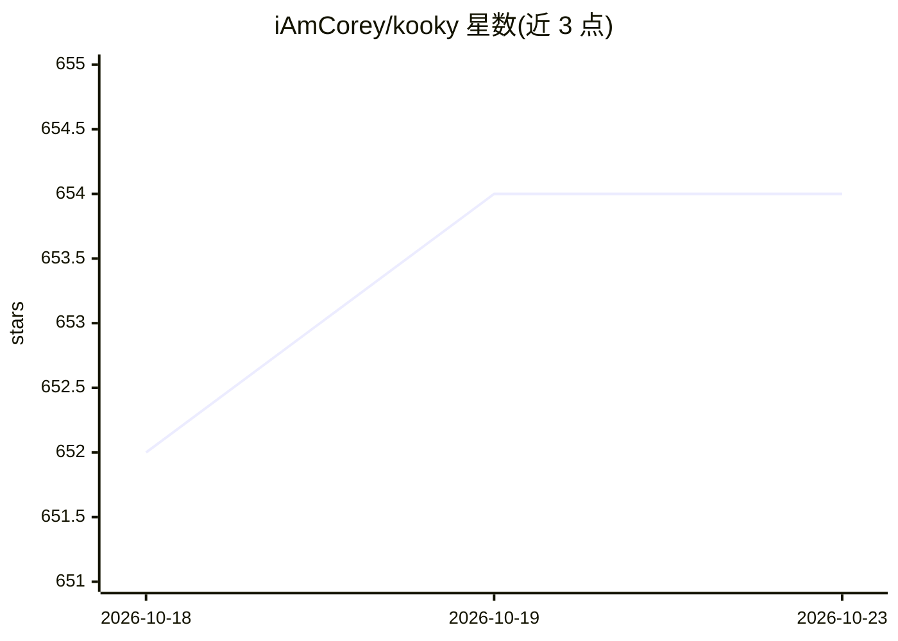

# iAmCorey/kooky

⭐ 654 · Swift · MIT · 推送 2026-10-12 · [GitHub](https://github.com/iAmCorey/kooky) · 个人维护 · 中文 README

**面向 AI 编码的 macOS 极简终端，一键启动并追踪编码 agent**

基于 libghostty GPU 渲染的 macOS 原生终端（Swift/SwiftUI），面向在终端中运行 CLI 编码 agent 的开发者。提供侧栏工作区、水平/垂直分屏、15 种内置 agent（Claude Code、Codex、Gemini CLI 等）一键启动与会话恢复、实时 agent 状态点与工具指示、SSH 远程工作区、git worktree 集成、通知中心与会话历史。也可自定义添加任意命令型 agent。无账号、无遥测，状态本地保存；仅支持 macOS，以应用下载方式分发，MIT 许可。

## 筛选速览

| 维度 | 判定 | 备注 |
|---|---|---|
| AI 角色 | `ai-enhanced` | 去掉 AI 部分产品仍成立 |
| 许可风险 | `permissive` | MIT |
| 部署形态 | `desktop` | 安装包/桌面程序 |
| 模型依赖 | locked-api |  |
| 硬件要求 | — | 无带数字的原话,不猜 |
| 安装摩擦 | `low` | 无编译、无系统依赖或容器化 |
| 成熟度 | — | 结构信号不足 |

## 能力要点

- 15 种内置 CLI agent 一键启动，按各 CLI 的 session ID 跨重启恢复会话
- 侧栏实时 agent 活动指示（运行/等待/空闲）与工具运行状态
- SSH 远程工作区：tab 与 agent 在远程主机运行并共享连接
- git worktree 创建/收养与最近项目快速打开

## 适用场景

- 在多个项目中并行运行和监控多个 CLI 编码 agent
- 让 agent 在独立 worktree 分支上工作而不干扰主分支
- 跨窗口统一查看哪个 agent 在等待自己并跳转处理

## 场景标签

 · 领域:开发者工具/终端

## 证据(README 行号)

> L15: A minimal modern terminal built for AI coding. Sidebar workspaces; horizontal / vertical split panes; one-click age
> L27: **One-click AI agent sessions.** Pick one from the `+` menu; the agent boots before your first prompt prints. All f

## 星数曲线

2026-10-18 652 → 2026-10-23 654（+2）

---
*卡片 v1 · prompt 1.4 · 生成 2026-10-22 · 置信度 mid · 依据 README sha `e98d63096a39` · [字段定义](../../DATASET.md)*
