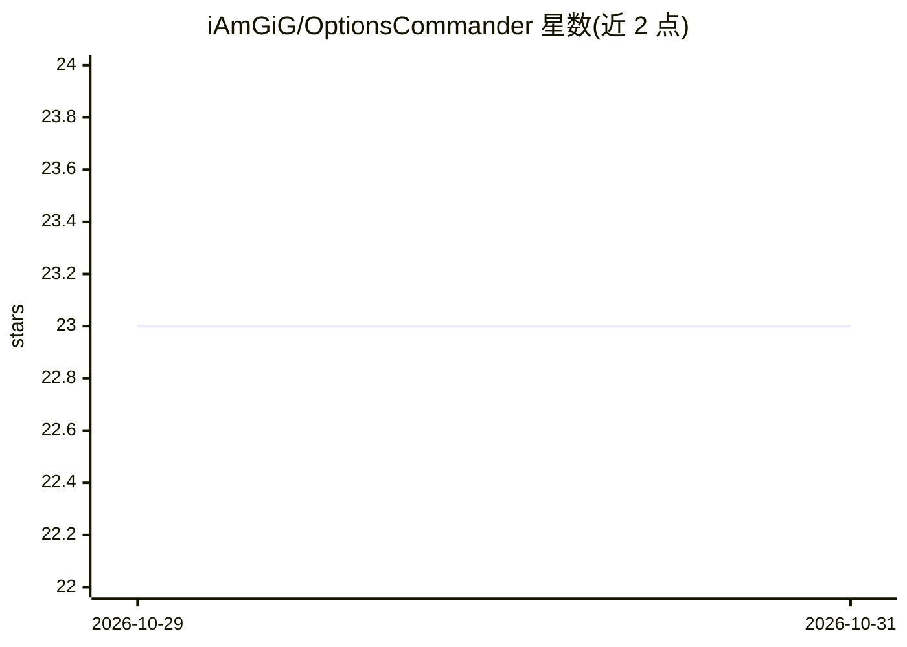

# iAmGiG/OptionsCommander

⭐ 23 · Python · AGPL-3.0 · 推送 2026-10-30 · [GitHub](https://github.com/iAmGiG/OptionsCommander) · [官网](https://github.com/iAmGiG/OptionsCommander/wiki) · 个人维护

**Alpaca 模拟账户上的多 agent 期权/股票交易研究平台**

基于 Microsoft Agent Framework（原 AutoGen）构建的多 agent 交易平台，通过 Alpaca Markets 模拟账户交易 MACD+RSI 共识投票策略，含人工监督。提供交互式 CLI 下单（GPT-4o-mini 做自然语言意图路由）、cron 定时例程管理移动止损与告警、SQLite 行情缓存与逐日报告。研究侧采用前向验证、样本外检验、交易成本与多重检验校正，README 公布的结论为现有实盘规则无超额收益、GEX 叠加策略已关闭。ScannerAgent/RiskAgent/ExecutorAgent 仍在开发中。

## 筛选速览

| 维度 | 判定 | 备注 |
|---|---|---|
| AI 角色 | `ai-enhanced` | 去掉 AI 部分产品仍成立 |
| 许可风险 | `viral` | AGPL-3.0 |
| 部署形态 | `library` | 以包/库形式分发 |
| 模型依赖 | — | README 未给出锁定关系 |
| 硬件要求 | — | 无带数字的原话,不猜 |
| 安装摩擦 | `low` | 无编译、无系统依赖或容器化 |
| 成熟度 | — | 结构信号不足 |

## 能力要点

- VoterAgent 生成 MACD(13/34/8)+RSI(14) 共识信号并在模拟账户运行
- GPT-4o-mini 自然语言意图路由，无硬编码关键词
- 早晚定时例程管理移动止损、告警、对账与每日报告
- 前向验证、交易成本、前视偏差保护与多重检验校正的研究流程

## 适用场景

- 在 Alpaca 模拟账户上用自然语言下单与查询持仓
- 定时自动维护移动止损并生成每日交易记录
- 对技术指标策略做含成本的样本外研究检验

## 场景标签

`多智能体` `金融量化` · 领域:Agent 开发

## 证据(README 行号)

> L26: **OptionsCommander** is a research-driven trading platform with a multi-agent AI architecture built on Microsoft Ag
> L84: - **Natural Language Commands**: GPT-4o-mini parses trade requests

## 星数曲线

2026-10-29 23 → 2026-10-31 23（+0）

---
*卡片 v1 · prompt 1.4 · 生成 2026-10-29 · 置信度 mid · 依据 README sha `b1113e33e818` · [字段定义](../../DATASET.md)*
