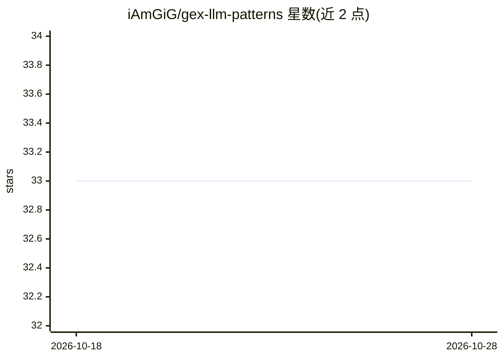

# iAmGiG/gex-llm-patterns

⭐ 33 · Python · AGPL-3.0 · 推送 2026-05-24 · [GitHub](https://github.com/iAmGiG/gex-llm-patterns) · 个人维护

**博士研究：用时间混淆测试验证 LLM 对期权 GEX 结构的推理能力**

学术研究代码仓库，研究 LLM 能否通过真实推理（而非记忆）检测期权市场做市商 Gamma 敞口（GEX）结构性约束。核心方法为时间混淆测试：剥离日期、代码与上下文标记，仅保留数值结构，迫使 LLM 依赖结构推理；配套 WHO→WHOM→WHAT 因果框架与 30 日窗口的机制分类标准。数据基于 PostgreSQL 存储 8,180 万份合约（2020-2025），LLM 使用 OpenAI o4-mini Batch API。已发表论文 2 篇（IEEE BigData 2025、AIAI 2026），JRFM 在审。声明仅为学术研究、非交易建议。

## 筛选速览

| 维度 | 判定 | 备注 |
|---|---|---|
| AI 角色 | `ai-knowledge` | 知识聚合/清单类 |
| 许可风险 | `viral` | AGPL-3.0 |
| 部署形态 | `library` | 以包/库形式分发 |
| 模型依赖 | — | README 未给出锁定关系 |
| 硬件要求 | — | 无带数字的原话,不猜 |
| 安装摩擦 | `low` | 无编译、无系统依赖或容器化 |
| 成熟度 | — | 结构信号不足 |

## 能力要点

- 时间混淆测试：剥离日期/代码/上下文，迫使 LLM 从数值结构推理
- 单日检测率 71.5%（混淆、无偏提示），预测准确率 90.9%
- 30 日机制检测 2024 年 81.2% vs 2020 年 12.1%，区分度 69.1pp
- 包含两篇已发表/录用论文与 JRFM 在审稿的 LaTeX 源

## 适用场景

- 复现 LLM 结构推理验证实验与论文结果
- 研究做市商 GEX 约束对市场微观结构的影响
- 参考时间混淆测试方法论设计防记忆污染的 LLM 评测

## 场景标签

`金融量化` `模型评测` · 领域:评测与运维

## 证据(README 行号)

> L15: PhD research investigating whether Large Language Models can detect structural constraints in financial markets thr
> L52: ### IEEE BigData 2025 ✅ Published — Single-Day Obfuscation Testing
> L54: **Title**: *Inferring Latent Market Forces: Evaluating LLM Detection of Gamma Exposure Patterns via Obfuscation Tes

## 星数曲线

2026-10-18 33 → 2026-10-28 33（+0）

---
*卡片 v1 · prompt 1.4 · 生成 2026-10-25 · 置信度 mid · 依据 README sha `5ba30432501e` · [字段定义](../../DATASET.md)*
