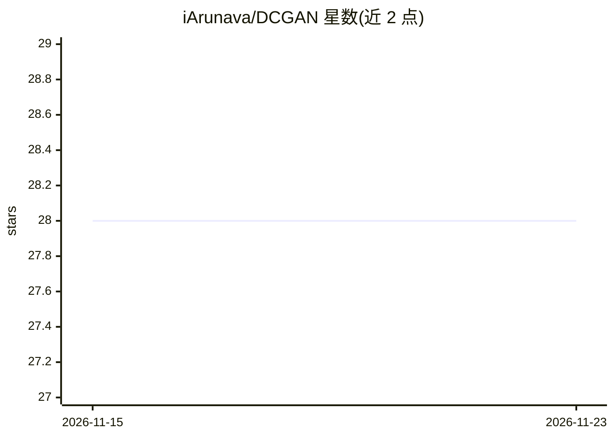

# iArunava/DCGAN

⭐ 28 · Jupyter Notebook · BSD-3-Clause · 推送 2026-11-15 · [GitHub](https://github.com/iArunava/DCGAN) · 个人维护

**用 PyTorch 复现 DCGAN 论文的实现与预训练模型**

个人复现 DCGAN 论文的项目：基于 PyTorch 实现生成对抗网络训练与预测流程，提供 init.py 脚本对 Oxford Flowers、Stanford Cars、Faces、Simpsons Faces 等数据集进行训练；发布多个数据集上训练后的生成器预训练模型（.pth），并配套 Colab notebook 供在浏览器中一键复现与使用预训练模型查看生成结果。训练前图像统一缩放至 64x64。

## 筛选速览

| 维度 | 判定 | 备注 |
|---|---|---|
| AI 角色 | `ai-native` | 本体是模型或模型工具 |
| 许可风险 | `permissive` | BSD-3-Clause |
| 部署形态 | `None` |  |
| 模型依赖 | — | README 未给出锁定关系 |
| 硬件要求 | — | 无带数字的原话,不猜 |
| 安装摩擦 | `low` | 无编译、无系统依赖或容器化 |
| 成熟度 | — | 结构信号不足 |

## 能力要点

- PyTorch 实现的 DCGAN 训练与预测命令行脚本
- 提供 Cars/Flowers/Simpsons Faces 等数据集的生成器预训练模型
- Colab notebook 支持浏览器中一键复现与生成

## 适用场景

- 学习 DCGAN 论文的 PyTorch 实现
- 用预训练生成器直接生成图像
- 在自己的数据集上训练 DCGAN

## 场景标签

`模型训练` `图像生成` · 领域:内容生成

## 证据(README 行号)

> L3: In this repository, I have reproduced the DCGAN paper. The paper can be found here: DCGAN
> L4: The implementation is done using PyTorch. I have also released pretrained models.

## 星数曲线

2026-11-15 28 → 2026-11-23 28（+0）

---
*卡片 v1 · prompt 1.4 · 生成 2026-11-18 · 置信度 high · 依据 README sha `1f29aa4527ac` · [字段定义](../../DATASET.md)*
