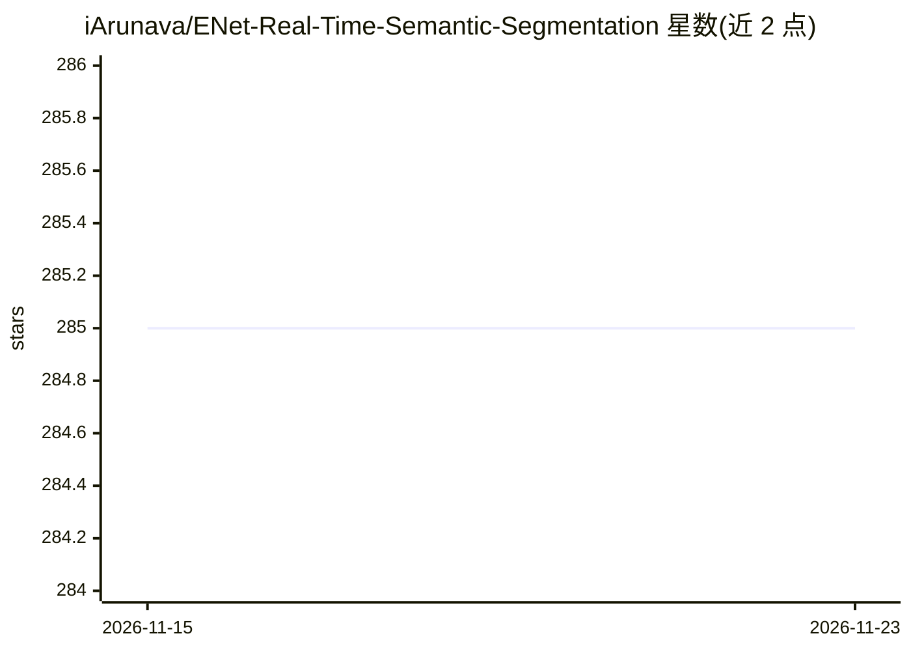

# iArunava/ENet-Real-Time-Semantic-Segmentation

⭐ 285 · Jupyter Notebook · BSD-3-Clause · 推送 2026-11-15 · [GitHub](https://github.com/iArunava/ENet-Real-Time-Semantic-Segmentation) · 个人维护

**ENet 实时语义分割网络的 PyTorch 复现实现**

复现 ENet 论文的 PyTorch 实现，面向深度学习开发与研究者，用于移动设备场景下的实时语义分割。提供训练与推理 CLI（init.py），可指定训练/标签集路径训练模型，或加载 .pth 预训练权重对单张图像做推理；附带可在 Google Colab 打开的 Jupyter notebook。需先运行 grab.sh 拉取运行时依赖。代码以 BSD v3 许可分发。

## 筛选速览

| 维度 | 判定 | 备注 |
|---|---|---|
| AI 角色 | `ai-native` | 本体是模型或模型工具 |
| 许可风险 | `permissive` | BSD-3-Clause |
| 部署形态 | `None` |  |
| 模型依赖 | — | README 未给出锁定关系 |
| 硬件要求 | — | 无带数字的原话,不猜 |
| 安装摩擦 | `low` | 无编译、无系统依赖或容器化 |
| 成熟度 | — | 结构信号不足 |

## 能力要点

- PyTorch 复现 ENet 实时语义分割架构
- CLI 支持训练模式与加载 .pth 权重推理
- 附带可在 Colab 运行的 notebook

## 适用场景

- 在自有数据集上训练 ENet 分割模型
- 加载预训练权重对图像做语义分割推理
- 对照论文学习 ENet 网络结构实现

## 场景标签

`目标检测` · 领域:感知与多模态

## 证据(README 行号)

> L5: A Neural Net Architecture for real time Semantic Segmentation.
> L6: In this repository we have reproduced the ENet Paper - Which can be used on
> L24: python3 init.py --mode train -iptr path/to/train/input/set/ -lptr /path/to/label/set/

## 星数曲线

2026-11-15 285 → 2026-11-23 285（+0）

---
*卡片 v1 · prompt 1.4 · 生成 2026-11-17 · 置信度 high · 依据 README sha `c026235a92e5` · [字段定义](../../DATASET.md)*
