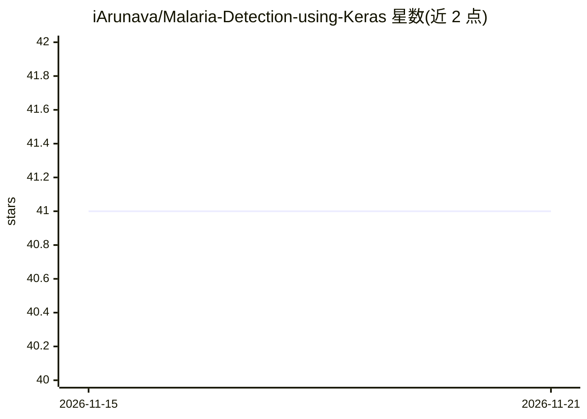

# iArunava/Malaria-Detection-using-Keras

⭐ 41 · Python · MIT · 推送 2026-11-15 · [GitHub](https://github.com/iArunava/Malaria-Detection-using-Keras) · [官网](https://malaria-classifier.now.sh/) · 个人维护

**用 Keras 从零训练 ResNet50 识别疟原虫血涂片图像**

基于 Keras 的疟疾检测图像分类项目：在 NIH 公开的血涂片数据集上从零训练 ResNet50，将细胞图像分为 Parasitized（感染）与 Uninfected（未感染）两类。通过 git clone 获取源码，运行下载脚本获取数据集后，用 train_model.py 对单张或多张图像进行推理。另提供基于 Zeit（now）的部署流程，将模型以 Web 服务形式上线，并给出在线部署示例链接。面向图像分类与医学影像方向的开发者与学习者。

## 筛选速览

| 维度 | 判定 | 备注 |
|---|---|---|
| AI 角色 | `ai-native` | 本体是模型或模型工具 |
| 许可风险 | `permissive` | MIT |
| 部署形态 | `library` | 以包/库形式分发 |
| 模型依赖 | — | README 未给出锁定关系 |
| 硬件要求 | — | 无带数字的原话,不猜 |
| 安装摩擦 | `low` | 无编译、无系统依赖或容器化 |
| 成熟度 | — | 结构信号不足 |

## 能力要点

- 从零训练的 ResNet50 分类模型（Keras 实现）
- 支持单张图像与批量图像集推理
- 提供基于 Zeit/now 的模型 Web 部署流程

## 适用场景

- 对疟疾血涂片细胞图像做感染/未感染分类推理
- 学习 Keras 医学影像分类的完整训练与部署流程
- 参考将 Keras 模型部署为 Web 服务的方法

## 场景标签

`目标检测` · 领域:感知与多模态

## 证据(README 行号)

> L3: This project uses Keras to detect Malaria from Images. The model used is a ResNet50 which is trained from scratch.
> L45: The model is deployed to production and you can use the model to test on your own images!!

## 星数曲线

2026-11-15 41 → 2026-11-21 41（+0）

---
*卡片 v1 · prompt 1.4 · 生成 2026-11-18 · 置信度 mid · 依据 README sha `6fd537775e6c` · [字段定义](../../DATASET.md)*
