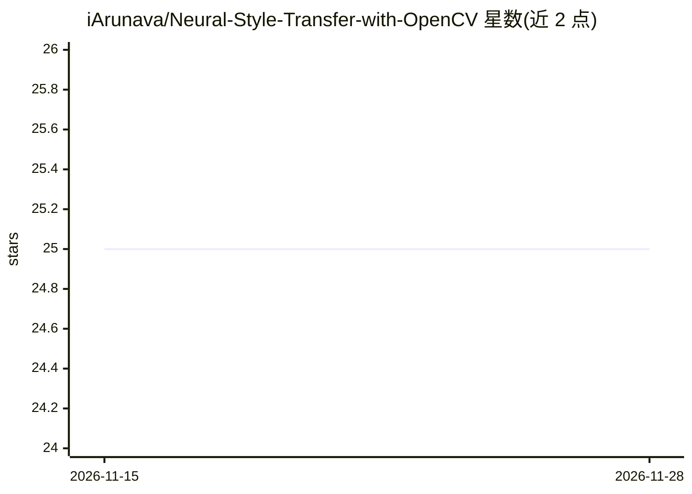

# iArunava/Neural-Style-Transfer-with-OpenCV

⭐ 25 · Python · 推送 2026-11-15 · [GitHub](https://github.com/iArunava/Neural-Style-Transfer-with-OpenCV) · 个人维护

**用 OpenCV 与预训练模型做图像/视频风格迁移的演示项目**

演示如何使用 OpenCV 执行神经风格迁移：加载 Justin Johnson 等人 Perceptual Losses 论文的预训练 Torch 模型，对输入图像或摄像头视频应用多种艺术风格。代码跟随 pyimagesearch 博客教程实现，支持命令行参数指定图像路径与切换风格（按 n/p 键）。以 Python 脚本形式提供，需 git clone 源码后运行，面向学习图像风格迁移的开发者。

## 筛选速览

| 维度 | 判定 | 备注 |
|---|---|---|
| AI 角色 | `ai-native` | 本体是模型或模型工具 |
| 许可风险 | `none` | — |
| 部署形态 | `None` |  |
| 模型依赖 | — | README 未给出锁定关系 |
| 硬件要求 | — | 无带数字的原话,不猜 |
| 安装摩擦 | `low` | 无编译、无系统依赖或容器化 |
| 成熟度 | — | 结构信号不足 |

## 能力要点

- 图像模式与视频模式两种运行方式
- 使用 Johnson et al. Perceptual Losses 预训练模型
- 视频模式中按 n/p 键切换风格
- 支持 --help 查看更多命令行参数

## 适用场景

- 给照片应用艺术风格迁移效果
- 实时摄像头视频的风格迁移演示
- 学习 OpenCV 加载深度学习模型的方法

## 场景标签

`图像生成` `教程课程` · 领域:内容生成

## 证据(README 行号)

> L3: This repo shows how to perform Neural Style Transfer using OpenCV.
> L4: This project uses the pretrained models by Justin Johnson

## 星数曲线

2026-11-15 25 → 2026-11-28 25（+0）

---
*卡片 v1 · prompt 1.4 · 生成 2026-11-18 · 置信度 high · 依据 README sha `4ace379ce849` · [字段定义](../../DATASET.md)*
