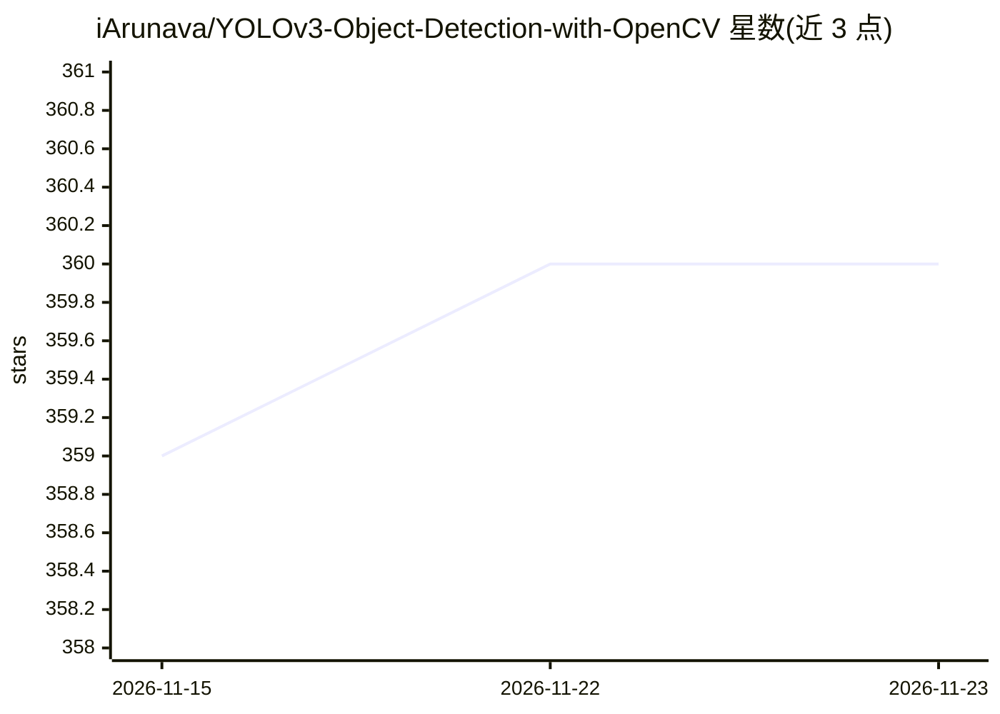

# iArunava/YOLOv3-Object-Detection-with-OpenCV

⭐ 360 · Shell · MIT · 推送 2026-11-15 · [GitHub](https://github.com/iArunava/YOLOv3-Object-Detection-with-OpenCV) · 个人维护

**用预训练 YOLOv3 对图片/视频/摄像头做目标检测**

基于 OpenCV 的 YOLOv3 目标检测实现：读取预训练的 yolov3-coco 权重与配置，对本地图片、视频文件执行目标检测分类，并支持通过摄像头实时检测。模型来自 2018 年 YOLOv3 论文，实现参考 darknet。使用方式为克隆仓库后运行 yolo.py 脚本，需自备 weights 与 config 文件置于 yolov3-coco 目录，可用 grab.sh 获取运行时依赖。代码以 MIT 许可分发。

## 筛选速览

| 维度 | 判定 | 备注 |
|---|---|---|
| AI 角色 | `ai-native` | 本体是模型或模型工具 |
| 许可风险 | `permissive` | MIT |
| 部署形态 | `None` |  |
| 模型依赖 | — | README 未给出锁定关系 |
| 硬件要求 | — | 无带数字的原话,不猜 |
| 安装摩擦 | `low` | 无编译、无系统依赖或容器化 |
| 成熟度 | — | 结构信号不足 |

## 能力要点

- 支持图片、视频文件与摄像头实时三种推理模式
- 使用 YOLOv3 预训练模型（yolov3-coco 权重与配置）
- 通过命令行参数指定媒体路径，--help 查看详情

## 适用场景

- 对本地图片或视频执行目标检测
- 用摄像头做实时目标检测演示
- 学习 YOLOv3 + OpenCV 推理流程的入门项目

## 场景标签

`目标检测` · 领域:感知与多模态

## 证据(README 行号)

> L5: This project implements an image and video object detection classifier using pretrained yolov3 models.
> L6: The yolov3 models are taken from the official yolov3 paper which was released in 2018. The yolov3 implementation is 

## 星数曲线

2026-11-15 359 → 2026-11-23 360（+1）

---
*卡片 v1 · prompt 1.4 · 生成 2026-11-17 · 置信度 high · 依据 README sha `82224526a094` · [字段定义](../../DATASET.md)*
