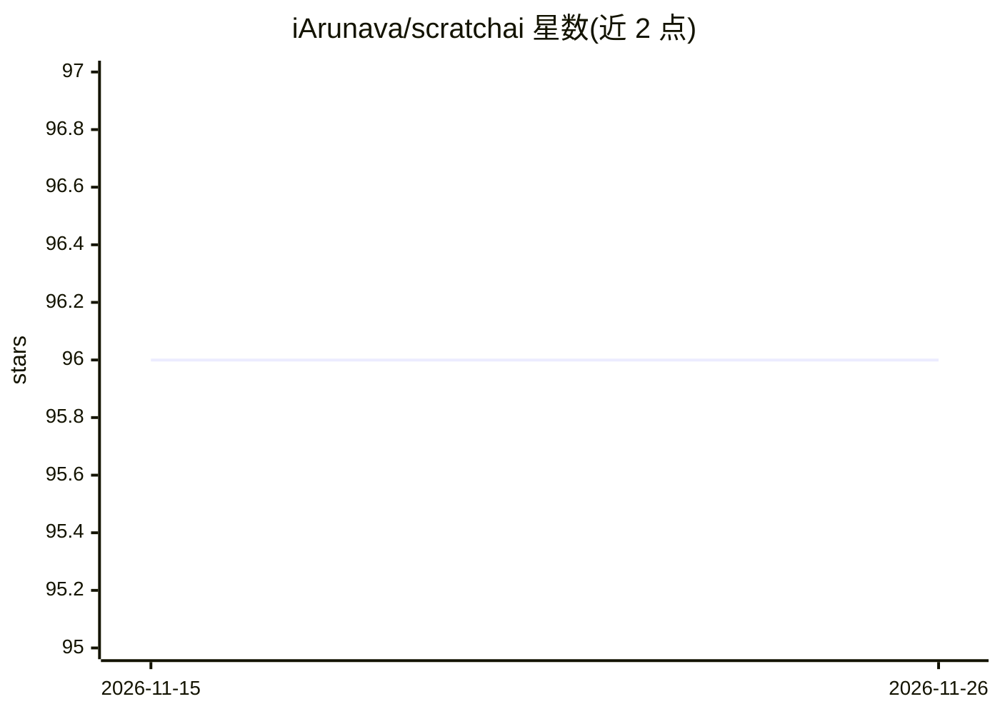

# iArunava/scratchai

⭐ 96 · Python · MIT · 推送 2026-11-15 · [GitHub](https://github.com/iArunava/scratchai) · 个人维护

**收录常见深度学习算法与对抗攻击的 PyTorch 库**

以 PyTorch 为主题标签的深度学习库，目标是收录深度学习算法并提供简洁调用。README 以目录形式列出五类实现：分类（LeNet/AlexNet/VGG/ResNet/GoogLeNet，部分含多配置）、分割（UNet/ENet）、GAN（CycleGAN）、风格迁移，以及对抗攻击（Noise/Semantic/FGM/PGD/DeepFool）。每个条目附论文链接，部分实现标注未校验或进行中；提供教程目录并接受贡献，MIT 许可。README 未给出安装命令与用法示例。

## 筛选速览

| 维度 | 判定 | 备注 |
|---|---|---|
| AI 角色 | `ai-native` | 本体是模型或模型工具 |
| 许可风险 | `permissive` | MIT |
| 部署形态 | `None` |  |
| 模型依赖 | — | README 未给出锁定关系 |
| 硬件要求 | — | 无带数字的原话,不猜 |
| 安装摩擦 | `low` | 无编译、无系统依赖或容器化 |
| 成熟度 | — | 结构信号不足 |

## 能力要点

- 分类模型实现覆盖 LeNet 至 ResNet 系列（含 BN/Dilated 变体）
- 含 UNet/ENet 分割与 CycleGAN、风格迁移实现
- 对抗攻击实现：FGM、PGD、DeepFool、Semantic 等，附论文链接

## 适用场景

- 以简洁调用使用常见分类/分割/生成模型
- 复现论文中的对抗攻击方法
- 学习各类深度学习算法的参考实现

## 场景标签

`教程课程` · 领域:学习与行业

## 证据(README 行号)

> L11: 1. Classification
> L42: 5. Attacks

## 星数曲线

2026-11-15 96 → 2026-11-26 96（+0）

---
*卡片 v1 · prompt 1.4 · 生成 2026-11-17 · 置信度 low · 依据 README sha `3730001b6f39` · [字段定义](../../DATASET.md)*
