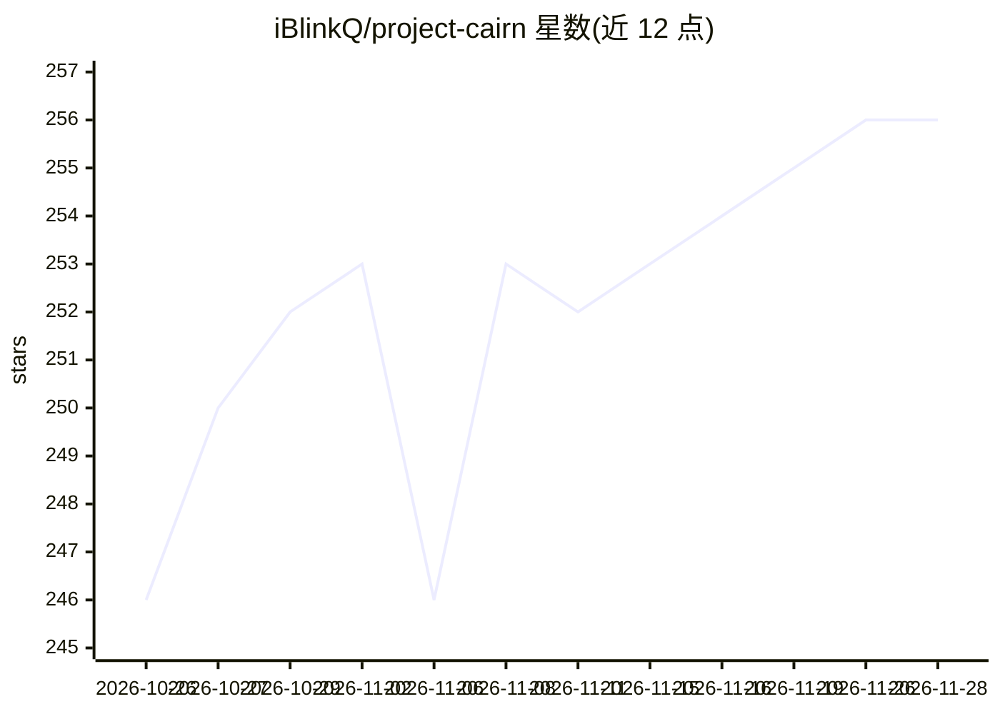

# iBlinkQ/project-cairn

⭐ 256 · Shell · MIT · 推送 2026-11-10 · [GitHub](https://github.com/iBlinkQ/project-cairn) · 个人维护 · 中文 README

**让 AI 编码代理把项目经验沉淀为可复用知识的技能**

Project Cairn 是一个面向 Claude Code、Codex 等 skill 兼容代理的技能包：在日常工作回合中，代理按项目根目录 AGENTS.md 中的规则维护 LOG.md、ROADMAP.md、主题笔记等文件，记录进展与已验证结论。当某条经验可能跨项目复用时，代理提出'毕业'候选，经用户确认后才写入长期知识库（支持 Obsidian、Notion、飞书 wiki 三种已验证路径），并记录 provenance 元数据。安装方式为 git clone 到对应代理的技能目录；依赖 git 与 bash（Windows 需 WSL/Git Bash），无包管理器发布。

## 筛选速览

| 维度 | 判定 | 备注 |
|---|---|---|
| AI 角色 | `ai-native` | 本体是模型或模型工具 |
| 许可风险 | `permissive` | MIT |
| 部署形态 | `None` |  |
| 模型依赖 | — | README 未给出锁定关系 |
| 硬件要求 | — | 无带数字的原话,不猜 |
| 安装摩擦 | `low` | 无编译、无系统依赖或容器化 |
| 成熟度 | — | 结构信号不足 |

## 能力要点

- 项目侧/知识库侧双生命周期分离，人工确认后才写入长期知识库
- 支持 Obsidian、Notion、Lark/飞书 wiki 三种毕业路径及只读 preflight 脚本
- 笔记遵循 Open Knowledge Format 最小约定并携带 provenance 字段
- 无后台 hook，维护发生在正常工作回合内

## 适用场景

- 多个 AI 协作项目间复用踩坑经验与关键决策
- 在 Claude Code 与 Codex 之间切换时不重复解释项目上下文
- 把已有项目文件夹中的经验一次性提炼入 Obsidian/Notion/飞书知识库
- 审计知识库中缺失索引或格式不完整的笔记

## 场景标签

`编码 Agent` `知识库管理` · 领域:编码与开发

## 证据(README 行号)

> L20: Project Cairn is an agent skill. During normal project work, it helps the agent keep validated pitfall lessons, key
> L36: Project Cairn is useful when you run several AI-collaboration projects, switch between skill-compatible agents such
> L38: ## Install

## 星数曲线

2026-10-26 246 → 2026-11-28 256（+10）

---
*卡片 v1 · prompt 1.4 · 生成 2026-11-26 · 置信度 high · 依据 README sha `402ba7bc5565` · [字段定义](../../DATASET.md)*
