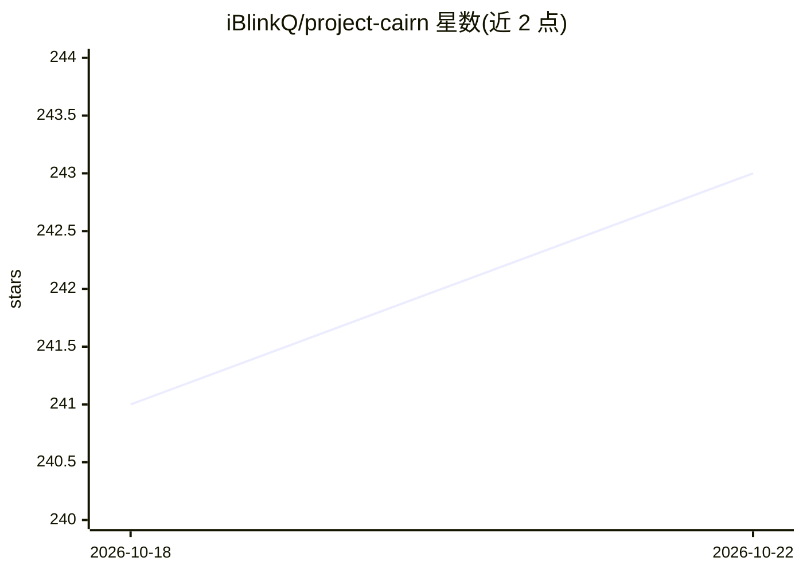

# iBlinkQ/project-cairn

⭐ 243 · Shell · MIT · 推送 2026-10-14 · [GitHub](https://github.com/iBlinkQ/project-cairn) · 个人维护 · 中文 README

**面向 Claude Code/Codex 的 agent 技能：把项目经验沉淀为可复用知识**

以 SKILL.md 形式分发的 agent skill，装在 Claude Code、Codex、WorkBuddy 等技能兼容 agent 中。工作机理：在项目内用 AGENTS.md 承载规则，cairn/ 目录下用 LOG.md、ROADMAP.md、topic 笔记维护进度与当前结论；经验经人工确认后“毕业”写入 Obsidian、Notion 或 Lark/飞书知识库，后续项目先检索再引用（Cited.md 留指针）。无后台钩子，写入长期知识库必须人工确认；依赖 git 与 bash，Windows 需 WSL 或 Git Bash，尚无包管理器发布。

## 筛选速览

| 维度 | 判定 | 备注 |
|---|---|---|
| AI 角色 | `ai-ecosystem` | LLM/agent 周边工具 |
| 许可风险 | `permissive` | MIT |
| 部署形态 | `None` |  |
| 模型依赖 | — | README 未给出锁定关系 |
| 硬件要求 | — | 无带数字的原话,不猜 |
| 安装摩擦 | `low` | 无编译、无系统依赖或容器化 |
| 成熟度 | — | 结构信号不足 |

## 能力要点

- AGENTS.md + cairn/ 目录的项目侧知识结构（规则/日志/路线图/主题结论）
- 人工确认的 graduation 流程，经验经蒸馏写入 Obsidian/Notion/Lark 飞书并带 provenance
- 复用时先检索、命中后在 Cited.md 留指针而非复制
- 提供三个知识库的 preflight 只读检查脚本

## 适用场景

- 多个 AI 协作项目间沉淀和复用踩坑经验
- 切换 agent 或新会话时避免重复解释上下文
- 把项目中验证过的结论归档到 Obsidian/Notion/飞书知识库

## 场景标签

`知识库管理` `Agent 记忆` · 领域:Agent 开发

## 证据(README 行号)

> L20: Project Cairn is an agent skill. During normal project work, it helps the agent keep validated pitfall lessons, key
> L36: Project Cairn is useful when you run several AI-collaboration projects, switch between skill-compatible agents such

## 星数曲线

2026-10-18 241 → 2026-10-22 243（+2）

---
*卡片 v1 · prompt 1.4 · 生成 2026-10-22 · 置信度 high · 依据 README sha `1ab14c11c9e1` · [字段定义](../../DATASET.md)*
